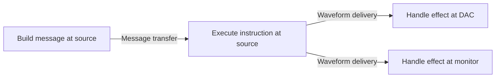

# Annotated Step Topologies

Status: initial design proposal with a runnable
[`annotated_route`](../crates/vihaco-runtime/examples/annotated_route.rs)
prototype. New routing APIs remain local to the example.

## Purpose

Describe each `Step<F, I, Context>` as a static topology graph. Computation nodes
build a message, execute an instruction, and handle its effects. Edges transfer
payloads between those nodes. Both nodes and edges support arbitrary static or
runtime annotations, interpreted by the context passed to the step.

The graph must expose destinations, operation kinds, connections, payload types,
and annotation types without executing application behavior. It is both a
readable description of machine flow and the structure an interpreter executes.
The earlier `../vihaco-static-top-experiment` provides the historical starting
point for typed routes and owned continuations.

## Routes as static topologies

A route declares the structure of one step as concrete Rust types: which
computations exist, where they occur, which payloads connect them, and which
branches receive the results. The builder materializes that declaration as a
value. Its nodes and connections can be inspected without invoking message
builders, instruction execution, or effect handlers.

"Static" describes the declared structure, not all the data flowing through it.
Instructions, prepared messages, effects, and runtime annotation values can vary
between invocations of the same route type. A scheduler can change when work
becomes ready while retaining the declared endpoints and dependencies. Failure
can prevent a downstream node from running without changing the topology that
was declared.

For example, a fixed 7 ns DAC delivery and a runtime-valued DAC delivery both
connect the source's execution node to the DAC's handling node. Their annotation
representations differ, but both connections are explicit before any waveform
exists. The context interprets these descriptions; it does not discover their
destinations by running arbitrary application callbacks.

The topology is a graph of computation and transfer, rather than a map of
physical devices alone. A destination identifies where computation occurs;
the operation kind distinguishes separate nodes at that destination. The
connections express payload flow and dependency, independently of the physical
transport used by an interpreter. Runtime-selected destinations would require
an explicit dynamic-boundary model, which the prototype does not provide.

## Nodes and edges

A node identifies a computation at a destination. A destination can host more
than one node: message construction and instruction execution both occur at the
source field in this example. They are distinct computations with a message
transfer edge between them.



The example contains four nodes and three edges:

| Graph element | Location or connection | Behavior |
| --- | --- | --- |
| Message construction node | Source field | Resolve and validate execution input through `BuildMessage` |
| Message transfer edge | Source message node to source execution node | Make the prepared message available to execution |
| Instruction execution node | Source field | Invoke its `Execute<I>` once |
| DAC delivery edge | Source execution node to DAC handling node | Make the waveform effect available to the DAC |
| DAC handling node | DAC field | Apply receiver behavior through `Receive<E>` |
| Monitor delivery edge | Source execution node to monitor handling node | Make the waveform effect available to the monitor |
| Monitor handling node | Monitor field | Apply receiver behavior through `Receive<E>` |

Edges express logical payload availability even when both endpoints occupy the
same component. They need not correspond to physical network transport. The
initial borrowed instruction enters at the route boundary; an incoming
instruction-delivery edge is not modeled by this prototype.

## Step boundary

Each declared step contains exactly one instruction execution node:

```text
Build message -> transfer message -> Execute instruction -> propagate effects
```

Failures can prevent execution, and scheduling can defer it. Neither changes the
single-execution boundary. `Execute` refers exclusively to instruction execution.
Receiver computation is a separate node using a separate contract:

```rust,ignore
trait Receive<E> {
    fn receive(&mut self, effect: E) -> eyre::Result<()>;
}
```

Delivery makes an effect available; handling applies it. Handling does not
implicitly invoke another instruction. Any subsequent instruction execution
belongs to another step; how such steps are initiated remains open.

Builder states enforce the phase progression. `.execute()` is available after
message-transfer configuration and disappears once selected. Propagation
builders provide `.handle_effect()`, with no instruction-execution method.

## Authoring a topology

The fixed-timing route in the prototype is:

```rust,ignore
route_through::<field!(Machine::source)>()
    .build_message::<commands::Fire>()
    .annotate::<ComputeTimeNs<2>>()
    .forward_message()
    .annotate::<DeliveryLatencyNs<1>>()
    .execute()
    .annotate::<ComputeTimeNs<3>>()
    .fan_out((
        deliver_to::<DacField>()
            .annotate::<DeliveryLatencyNs<7>>()
            .handle_effect()
            .annotate::<ComputeTimeNs<4>>(),
        deliver_to::<MonitorField>()
            .annotate_with(TraceLabel("monitor delivery"))
            .handle_effect()
            .annotate::<ComputeTimeNs<1>>(),
    ))
    .start(self, context, instruction)
```

Each annotation decorates the immediately preceding node or edge. The monitor
edge demonstrates an application annotation other than timing; this scheduler
records the label and applies zero transfer delay.

`route_through::<F>()` selects the instruction field directly. The machine type
is inferred from `self` at `.start(...)`, where compatibility bounds are checked.
Field markers identify declaration fields and may be shared by generic
instantiations; they cannot determine a concrete parent type on their own.
`deliver_to::<F>()` creates an edge directly, without a separate branch starter.

The prototype uses explicit `DacField` and `MonitorField` implementations. These
are effect-only receivers, while the current composite macro generates field
routes for instruction devices. Generated accessors should eventually permit
`deliver_to::<field!(Machine::dac)>()` and the equivalent monitor spelling.

Construction describes the graph without executing it. `.topology::<Machine>()`
inspects it without requiring a machine instance, context, or instruction value.
`.start(...)` begins interpretation using borrowed machine and context access.

### Waveform computation

`Fire` contains an output channel and an amplitude multiplier. Its custom
`BuildMessage` implementation loads waveform samples and calibration from
machine state into an owned `PulseMessage`. The source's `Execute` computes:

```text
output_sample = sample * instruction_amplitude * calibration_gain + offset
```

The resulting waveform is delivered to two receivers. The DAC handler validates
its output range and records the waveform. The monitor handler records sample
count and peak amplitude. Application logic stays in these implementations;
routing destinations stay explicit in the graph.

### Dynamic timings

The runtime route uses the same nodes and connections, attaching runtime values:

```rust,ignore
.build_message::<commands::FireRuntime>()
.annotate_with(DynamicComputeTime(Duration::from_nanos(2)))
.forward_message()
.annotate_with(DynamicLatency(Duration::from_nanos(1)))
.execute()
.annotate_with(DynamicComputeTime(execution_duration))
```

Runtime annotations can also decorate delivery edges and handling nodes. The
example's runtime route uses runtime-valued computation durations for message
construction and both handlers, as well as runtime delivery latencies. A mixed
route combines fixed computation durations with runtime DAC delivery latency.
Dynamic data changes annotation values, not the graph's connections.

## Graph description

The prototype exposes structured metadata rather than a list of opaque operation
names:

```rust,ignore
enum Element {
    Node {
        site: Site,
        instruction: Option<&'static str>,
        input: &'static str,
        output: &'static str,
    },
    Edge {
        kind: EdgeKind,
        from: Site,
        to: Site,
        payload: &'static str,
    },
}

struct Part {
    element: Element,
    annotation: Annotation,
}
```

A `Site` identifies the concrete machine type, field-marker type, display name,
and computation kind: message building, instruction execution, or effect
handling. An edge identifies message transfer or effect delivery and references its
producer and consumer sites. Repeated
connections from the execution node describe fan-out; fan-out is structural
composition rather than a computation node in this prototype.

`Annotation` identifies absent, static, or runtime metadata and retains the
annotation's Rust type name. Static type names include const parameters. Runtime
values are owned by the graph but are not exposed by this inspection format.

The same `Element` metadata is available from owned work submitted to the
context. The scheduler can distinguish a computation from a transfer and record
readiness and completion/arrival times without inspecting application code.

This representation demonstrates inspection, not a stable export format. Rust
type names are diagnostic strings, not persistent identifiers. Repeated
occurrences of the same computation at one field would need occurrence
identifiers; the example has one node per field/computation-kind pair. Complete
typed field paths preserve nested-route identity; final field names alone do not.

## Annotation model

The attachment point and the annotation representation are independent:

| Attachment | Static form | Runtime form |
| --- | --- | --- |
| Computation node | `.annotate::<ComputeTimeNs<3>>()` | `.annotate_with(DynamicComputeTime(duration))` |
| Transfer edge | `.annotate::<DeliveryLatencyNs<7>>()` | `.annotate_with(DynamicLatency(delay))` |

The builder's current phase determines the attachment point. For example:

```rust,ignore
deliver_to::<DacField>()
    .annotate::<DeliveryLatencyNs<7>>() // Edge: source output to DAC input.
    .handle_effect()
    .annotate_with(DynamicComputeTime(duration)) // Node: DAC handling work.
```

These describe independent costs. The edge annotation governs payload arrival;
the node annotation governs computation after arrival. Annotating a node does
not annotate its incoming or outgoing edges, and annotating one branch does not
annotate its siblings. Annotations are attached to the graph description and
preserved through interpretation, rather than applied to arbitrary statements
inside an operation's implementation.

Annotations remain application-defined. Resource requirements, tracing, and
priority are other possible meanings. The routing core does not mandate timing
semantics or restrict annotation meanings to nodes or edges.

One `Context<M, A>` trait handles both representations:

```rust,ignore
struct Static<A>(PhantomData<fn() -> A>);
struct Dynamic<A>(A);

trait Context<M, A>: Sized {
    fn submit<W>(
        &self,
        machine: &mut M,
        annotation: A,
        work: W,
    ) -> eyre::Result<()>
    where
        W: Resume<M, Self> + 'static;
}
```

`.annotate::<A>()` supplies a zero-sized static marker. It never constructs an
`A` value or requires `Default`. `.annotate_with(value)` supplies an owned
`Dynamic<A>`. Context implementations distinguish them through trait parameters.
An annotation can also combine static resource identity with runtime quantities.

Required context implementations appear in step bounds. A single generic
implementation can interpret a fixed annotation across constants and compatible
machines. The example scheduler rejects computation-duration annotations on
edges and delivery-latency annotations on nodes when work is submitted. Such
placement checks are interpreter policy; statically enforcing selected policies
could be added later.

The current builder supports one annotation per node or edge. Accumulating
annotations and defining interactions among them remains open. Type-level data
makes static checks and specialized interpretation possible; it does not by
itself implement compile-time graph analysis.

## Context and timing semantics

The immediate context ignores annotations and completes the graph synchronously.
The scheduler interprets node computation duration and edge delivery latency
separately. Inputs are ready when a part is submitted. A computation's modeled
start is that readiness time; the scheduler applies its body atomically at
completion, making outputs available then:

```text
node_completion = node_start + computation_duration
edge_arrival = producer_completion + delivery_latency
consumer_start = edge_arrival
```

The last equation assumes no resource contention. This simulator does not reserve
resources or mutate state at computation start. A hardware interpreter could
instead initiate work and await completion, while retaining the same graph.

For fixed timings:

| Event | Time |
| --- | --- |
| Message construction becomes ready | 0 ns |
| Message construction completes | 2 ns |
| Prepared message arrives at instruction execution | 3 ns |
| Instruction completes and produces waveform | 6 ns |
| Monitor receives waveform | 6 ns |
| Monitor handling completes | 7 ns |
| DAC receives waveform | 13 ns |
| DAC handling completes | 17 ns |

Arrival at the DAC does not apply its receiver handler. It submits a separate
four-nanosecond computation. That distinction is observable in both the graph
and scheduler records.

The scheduler orders equal deadlines by submission sequence, advances modeled
time without wall-clock waits, and erases continuation types only in its queue.
It records each part's ready time, due time, and successful completion. The
example uses `Cell` and `RefCell` to work through `&Context`; this is a
single-threaded implementation choice. Unannotated parts run synchronously in
the prototype, so full interpreter control over those parts remains open.

## Ownership and message snapshots

Each deferred part owns its input and remaining graph. Execution borrows its
environment only while applying a part:

```text
Acquire borrowed environment
    -> apply ready part
    -> produce owned output and continuation
    -> submit the next node or edge
    -> release borrows
```

Submission initially clones the instruction. Message construction is itself
scheduled, so it reads samples and calibration when its computation body runs.
In this simulator that is at completion, 2 ns in the fixed route, rather than at
`Step` submission. The built message owns the snapshot thereafter: changes to
calibration during message transfer or instruction scheduling do not alter it.

The message-transfer continuation owns both the instruction and prepared message.
Instruction completion produces a waveform; each effect branch then owns its
payload through transfer and handling. The prototype clones the waveform for
one branch and moves it into the other.

`Resume<M, C>` exposes the part's `Element` description and resumes it with fresh
borrowed machine/context access. Other implementations might retain an owning
program reference and instruction index instead of cloning an instruction.
Consumers with different execution environments, multithreaded workers, and
alternative sharing strategies remain extension work. Queue work currently
requires `'static`, not `Send`.

The `BuildMessage` call still receives `()` as its preparation context.
Forwarding runtime preparation context and modeling explicit capture before a
computation starts require further design.

## Failures and completion

Successful `Step::step` means initial submission succeeded, not that the graph
completed. Message preparation can now fail later when its node runs. Instruction
execution and receiver handling can fail at their modeled completion times.
Failed parts do not produce downstream work; the scheduler returns the error.

Successful mutations, submissions, and other branches are not rolled back. A DAC
range failure can occur after the monitor has already completed. Cancellation,
retries, and aggregate completion reporting are unresolved. Finite topology
inspection and a single instruction execution remain independent of such
runtime outcomes.

## Framework and user responsibilities

The intended ordinary authoring surface is the machine declaration, component
behavior, and a route expression in each `Step`. The framework supplies graph
structure and ownership machinery.

| Concern | Provided by vihaco | Written or selected by the machine author |
| --- | --- | --- |
| Machine structure | Declaration macros, generated field markers, `Field` access | Components, composite fields, and state |
| Message construction | `BuildMessage` contract, existing automatic preparation, and a graph node invoking preparation | Application messages and custom resolvers where needed |
| Instruction execution | `Execute<I>` contract and field-directed execution node | Instructions and component execution behavior, or reused components |
| Step topology | Builder with phase checking, message edges, delivery edges, and handling nodes | Explicit destinations, connections, and node/edge annotations |
| Effect receiving | Receiving contract, field access, and payload compatibility bounds | Receiver behavior and application transformations |
| Annotation attachment | Static type markers and runtime value ownership | Chosen annotations, constants, values, and any custom annotation definitions |
| Interpretation | One `Context` extension contract and an immediate interpreter | A provided context or custom scheduling/resource policy |
| Deferred work | Typed stages, owned inputs, continuations, and resumption | Custom boundary representations only for specialized integrations |
| Description | Structured node/edge inspection and metadata on submitted work | Inspection calls and application-specific presentation |

Existing `Field`, `BuildMessage`, `Execute`, and `Step` already come from vihaco.
The new graph APIs are currently example-local. Machine authors should not need
to implement internal `Stage`, `Run`, `Work`, `Policy`, or builder state types.
These internals represent nodes and edges, enforce their composition, and
construct owned continuations. Explicit receiver field accessors are temporary
scaffolding pending generated access for effect-only destinations.

Annotation authors define new metadata and its context interpretation. Interpreter
authors implement submission, scheduling or recording, and any resource policy;
they reuse standard graph work. The example latency types, computation-duration
types, tracing label, and scheduler should be reusable policies, not copied into
every machine. Their eventual standard-library or optional-runtime packaging
remains open; a scheduler for every hardware environment is not assumed.

## Prototype and validation

| File | Responsibility |
| --- | --- |
| [framework.rs](../crates/vihaco-runtime/examples/annotated_route/framework.rs) | Typed graph operations, builder, structured description, and owned work |
| [contexts.rs](../crates/vihaco-runtime/examples/annotated_route/contexts.rs) | Node duration and edge latency interpretation, scheduling, and event records |
| [machine.rs](../crates/vihaco-runtime/examples/annotated_route/machine.rs) | Instructions, message builder, source execution, receivers, and authored steps |
| [annotated_route.rs](../crates/vihaco-runtime/examples/annotated_route.rs) | Inspection, runnable scenarios, and assertions |

```sh
cargo run -p vihaco-runtime --example annotated_route --features typed-declarations
cargo run -p vihaco-runtime --example annotated_route --features typed-declarations -- 2 4
```

Arguments supply instruction computation duration and DAC delivery latency in
nanoseconds. Other durations in the runtime route are runtime-valued annotations
with example defaults. For the second invocation:

| Route | Instruction completion | Monitor completion | DAC arrival | DAC completion |
| --- | --- | --- | --- | --- |
| Fixed | 6 ns | 7 ns | 13 ns | 17 ns |
| Runtime instruction duration 2 ns and DAC latency 4 ns | 5 ns | 6 ns | 9 ns | 13 ns |
| Fixed instruction duration and runtime DAC latency 4 ns | 6 ns | 7 ns | 10 ns | 14 ns |

Assertions cover graph connectivity and computation kinds, annotation storage
forms, one instruction execution, node and edge timing, calibrated output,
owned inputs across suspension, preparation and handling failures, and snapshot
timing. Focused execution, formatting, and Clippy checks validate the prototype.

## Integration questions

Before promoting the API into vihaco, resolve:

1. Generated fields for effect-only receivers and integration with existing
   effect-sink contracts.
2. Annotation accumulation, composition, and optional static placement checks.
3. Zero/one/many effects, variant selection, transformations, general fan-out,
   and payload sharing.
4. Resource-aware node starts, asynchronous computation completion, message
   capture semantics, and preparation context forwarding.
5. Owned program references, consumers with different execution environments,
   and threading requirements.
6. Stable topology export, node/edge occurrence identities, dynamic annotation
   inspection, nested paths, and compile-time analyses.
7. Completion, cancellation, recovery, and subsequent-step initiation.

The central constraints are explicit static connections, separately annotatable
computation nodes and transfer edges, exactly one instruction execution per step,
and owned continuation data at deferred boundaries.
