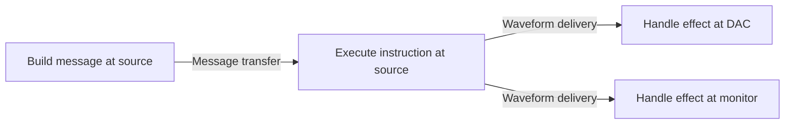

# Annotated Step Topologies

Status: initial design proposal with a runnable
[`annotated_route`](../crates/vihaco-runtime/examples/annotated_route.rs)
prototype. New routing APIs remain local to the example.

## Purpose

Describe each `Step<F, I, Context>` as a static topology graph. Computation nodes
build a message, execute an instruction, and handle its effects. Edges transfer
payloads between those nodes. Both nodes and edges support arbitrary static or
runtime annotations, interpreted by the context passed to the step.

The graph must expose destinations, operation kinds, connections, payload types,
and annotation types without executing application behavior. It is both a
readable description of machine flow and the structure an interpreter executes.
The earlier `../vihaco-static-top-experiment` provides the historical starting
point for typed routes and owned continuations.

## Routes as static topologies

A route declares the structure of one step as concrete Rust types: which
computations exist, where they occur, which payloads connect them, and which
branches receive the results. The builder materializes that declaration as a
value. Its nodes and connections can be inspected without invoking message
builders, instruction execution, or effect handlers.

"Static" describes the declared structure, not all the data flowing through it.
Instructions, prepared messages, effects, and runtime annotation values can vary
between invocations of the same route type. A scheduler can change when work
becomes ready while retaining the declared endpoints and dependencies. Failure
can prevent a downstream node from running without changing the topology that
was declared.

For example, a fixed 7 ns DAC delivery and a runtime-valued DAC delivery both
connect the source's execution node to the DAC's handling node. Their annotation
representations differ, but both connections are explicit before any waveform
exists. The context interprets these descriptions; it does not discover their
destinations by running arbitrary application callbacks.

The topology is a graph of computation and transfer, rather than a map of
physical devices alone. A destination identifies where computation occurs;
the operation kind distinguishes separate nodes at that destination. The
connections express payload flow and dependency, independently of the physical
transport used by an interpreter. Runtime-selected destinations would require
an explicit dynamic-boundary model, which the prototype does not provide.

## Route describes the entire annotated graph

`Route` is the public abstraction for a complete step topology. Its associated
`Graph` type is the canonical description of every computation node, payload
transfer edge, branch, and annotation:

```rust,ignore
trait Route: Sized {
    type Instruction;
    type Graph;

    fn graph(&self) -> &Self::Graph;
    fn into_graph(self) -> Self::Graph;
    // Default methods execute or optionally describe that same graph.
}
```

The builder returns a concrete `DeclaredRoute<I, Graph>` implementing this
trait. It selects `Graph` at compile time. Graph values contain the runtime
annotation bindings when needed; the built-in topology operations and static
annotations are zero-sized. The example checks that a route with no runtime
bindings occupies zero bytes.

The graph is a structured type composition. `Then<Operation, Annotation, Next>`
represents an annotated node or edge followed by its continuation, and
`FanOut<Left, Right>` represents branching. Operations retain their field and
instruction parameters, such as `BuildAt<Field, I>`, `MessageWire<Field>`,
`ExecuteAt<Field>`, `EffectWire<From, To>`, and `HandleAt<Field>`. Annotation
parameters retain `Static<A>` or `Dynamic<A>` at each graph position.

This combines the graph and executable-route models without maintaining two
independent descriptions. `Run` implementations compile that concrete graph
into direct typed calls; `Inspect` implementations optionally visit the same
concrete types. Execution does not construct or traverse a runtime graph,
resolve field names, or look up annotations in a registry.
Only a context that explicitly requests scheduling or other runtime behavior
introduces the state needed for it.

### Essential topology types

The core is `Route`, whose associated `Graph` is composed from annotated stages
and branching. The remaining interfaces construct, execute, suspend, or inspect
that same graph.

| Type or trait | Role |
| --- | --- |
| `Route` | Describes the complete step through its `Instruction` and `Graph` associated types |
| `DeclaredRoute<I, Graph>` | Concrete route returned by the builder; holds the graph's runtime bindings when present |
| `Stage<M, Input>` | Defines one computation or wire, its typed endpoints and payload, and how it produces its output |
| `Computation`, `Wire` | Type-level stage classifications used by context bounds and inspection callbacks |
| `Then<N, P, Next>` | Composes stage `N`, annotation policy `P`, and its continuation; `N` may be either a computation or a wire |
| `FanOut<L, R>` | Sends an effect into two branches; the prototype clones for one and moves into the other |
| `End` | Terminates a branch |
| `Static<A>`, `Dynamic<A>`, `Unannotated` | Represent type-only, value-bound, or absent annotations on a stage |

The concrete stage vocabulary is deliberately small:

| Stage | Computation or wire |
| --- | --- |
| `BuildAt<F, I>` | Builds instruction `I`'s message for field `F` |
| `MessageWire<F>` | Connects message construction to instruction execution at `F` |
| `ExecuteAt<F>` | Invokes the selected component's instruction execution |
| `EffectWire<From, To>` | Connects effect production to handling at another destination |
| `HandleAt<F>` | Applies the effect receiver's behavior at `F` |

`Stage` exposes `Kind`, `Source`, `Target`, `Instruction`, `Payload`, and `Output`
as associated types. A computation's source and target identify itself; a wire's
endpoints identify its producer and consumer computations. `Payload` describes
application data, while `Output` is the value passed to the continuation. For
example, message construction produces `PreparedInput<I, Message>`, which owns
the instruction alongside the message payload for later execution.

The example's graph composition is:

```text
Then<BuildAt>
  -> Then<MessageWire>
  -> Then<ExecuteAt>
  -> FanOut
       -> Then<EffectWire to DAC> -> Then<HandleAt DAC> -> End
       -> Then<EffectWire to monitor> -> Then<HandleAt monitor> -> End
```

Each `Then` has an independent annotation parameter. `Policy` submits annotated
work to `Context`, which supplies interpretation. `Run` executes the typed
composition; `Work<N, Input, Next>` owns a stage's input and continuation, and
`Resume` lets the context continue that work later. `Inspect` and `Visitor`
inspect the same graph through generic node and edge callbacks.

`Through`, `Building`, `Forwarding`, `Executing`, `Delivering`, and `Handling` are
builder states. They construct the graph while enforcing phase order and the
single instruction-execution boundary; they are not additional graph operations.

### Static execution and optional inspection

Node versus edge classification is also encoded in types. Each stage has an
associated `Kind`, using `Computation` or `Wire` markers. Owned work retains
its concrete operation, input, and continuation types. A context receives that
classification as a type parameter, so timing annotation compatibility can be
selected through trait resolution rather than runtime variant checks.

Inspection uses generic node and edge callbacks selected by the `Computation`
and `Wire` types. It does not materialize a tagged graph representation.
The example scheduler defaults to a zero-sized `NoRecording` observer; selecting
`RecordingScheduler` explicitly stores operation names and event times as
application diagnostic output. That output is not used for execution dispatch.

The optimization goal is no routing abstraction overhead relative to equivalent
handwritten Rust. An immediate route should simplify to the same essential
message preparation, instruction execution, and effect-handling calls. Runtime
annotation values, payload ownership, parking, and scheduling retain the costs
inherent in their requested behavior. The example scheduler's boxed queue is one
optional backend choice, not a requirement of `Route` or its graph. Code-generation
comparisons and benchmarks against handwritten baselines remain necessary to
validate this goal; zero-sized graph values alone do not prove it.

## Nodes and edges

A node identifies a computation at a destination. A destination can host more
than one node: message construction and instruction execution both occur at the
source field in this example. They are distinct computations with a message
transfer edge between them.



The example contains four nodes and three edges:

| Graph element | Location or connection | Behavior |
| --- | --- | --- |
| Message construction node | Source field | Resolve and validate execution input through `BuildMessage` |
| Message transfer edge | Source message node to source execution node | Make the prepared message available to execution |
| Instruction execution node | Source field | Invoke its `Execute<I>` once |
| DAC delivery edge | Source execution node to DAC handling node | Make the waveform effect available to the DAC |
| DAC handling node | DAC field | Apply receiver behavior through `Receive<E>` |
| Monitor delivery edge | Source execution node to monitor handling node | Make the waveform effect available to the monitor |
| Monitor handling node | Monitor field | Apply receiver behavior through `Receive<E>` |

Edges express logical payload availability even when both endpoints occupy the
same component. They need not correspond to physical network transport. The
initial borrowed instruction enters at the route boundary; an incoming
instruction-delivery edge is not modeled by this prototype.

## Step boundary

Each declared step contains exactly one instruction execution node:

```text
Build message -> transfer message -> Execute instruction -> propagate effects
```

Failures can prevent execution, and scheduling can defer it. Neither changes the
single-execution boundary. `Execute` refers exclusively to instruction execution.
Receiver computation is a separate node using a separate contract:

```rust,ignore
trait Receive<E> {
    fn receive(&mut self, effect: E) -> eyre::Result<()>;
}
```

Delivery makes an effect available; handling applies it. Handling does not
implicitly invoke another instruction. Any subsequent instruction execution
belongs to another step; how such steps are initiated remains open.

Builder states enforce the phase progression. `.execute()` is available after
message-transfer configuration and disappears once selected. Propagation
builders provide `.handle_effect()`, with no instruction-execution method.

## Authoring a topology

The fixed-timing route in the prototype is:

```rust,ignore
route_through::<field!(Machine::source)>()
    .build_message::<commands::Fire>()
    .annotate::<ComputeTime<ConstNs<2>>>()
    .forward_message()
    .annotate::<DeliveryLatency<ConstNs<1>>>()
    .execute()
    .annotate::<ComputeTime<ConstNs<3>>>()
    .fan_out((
        deliver_to::<DacField>()
            .annotate::<DeliveryLatency<ConstNs<7>>>()
            .handle_effect()
            .annotate::<ComputeTime<ConstNs<4>>>(),
        deliver_to::<MonitorField>()
            .annotate_with(TraceLabel("monitor delivery"))
            .handle_effect()
            .annotate::<ComputeTime<ConstNs<1>>>(),
    ))
    .start(self, context, instruction)
```

Each annotation decorates the immediately preceding node or edge. The monitor
edge demonstrates an application annotation other than timing; this scheduler
records the label and applies zero transfer delay.

`route_through::<F>()` selects the instruction field directly. The machine type
is inferred from `self` at `.start(...)`, where compatibility bounds are checked.
Field markers identify declaration fields and may be shared by generic
instantiations; they cannot determine a concrete parent type on their own.
`deliver_to::<F>()` creates an edge directly, without a separate branch starter.

The prototype uses explicit `DacField` and `MonitorField` implementations. These
are effect-only receivers, while the current composite macro generates field
routes for instruction devices. Generated accessors should eventually permit
`deliver_to::<field!(Machine::dac)>()` and the equivalent monitor spelling.

Construction describes the graph without executing it.
`.inspect::<Machine, _>(&mut visitor)` visits its types without requiring a
machine instance, context, or instruction value.
`.start(...)` begins interpretation using borrowed machine and context access.

### Waveform computation

`Fire` contains an output channel and an amplitude multiplier. Its custom
`BuildMessage` implementation loads waveform samples and calibration from
machine state into an owned `PulseMessage`. The source's `Execute` computes:

```text
output_sample = sample * instruction_amplitude * calibration_gain + offset
```

The resulting waveform is delivered to two receivers. The DAC handler validates
its output range and records the waveform. The monitor handler records sample
count and peak amplitude. Application logic stays in these implementations;
routing destinations stay explicit in the graph.

### Dynamic timings

The runtime route uses the same nodes and connections, attaching runtime values:

```rust,ignore
.build_message::<commands::FireRuntime>()
.annotate_with(ComputeTime(RuntimeTime(Duration::from_nanos(2))))
.forward_message()
.annotate_with(DeliveryLatency(RuntimeTime(Duration::from_nanos(1))))
.execute()
.annotate_with(ComputeTime(RuntimeTime(execution_duration)))
```

Runtime annotations can also decorate delivery edges and handling nodes. The
example's runtime route uses runtime-valued computation durations for message
construction and both handlers, as well as runtime delivery latencies. A mixed
route combines fixed computation durations with runtime DAC delivery latency.
Dynamic data changes annotation values, not the graph's connections.

## Graph description

The graph describes itself through associated types. Each `Stage<M, Input>`
exposes its computation/transfer `Kind`, `Source`, `Target`, `Instruction`,
`Payload`, and `Output` types. For a computation, source and target identify that
operation itself. A message-transfer edge names `BuildAt<Field, I>` as its source
and `ExecuteAt<Field>` as its target. An effect-transfer edge names
`ExecuteAt<From>` and `HandleAt<To>`.

These connections are available before payloads exist. Field types retain nested
path identity; the concrete machine is the `M` parameter. Display-name accessors
read the fields' source names only when a caller explicitly requests them.

Optional inspection walks the statically selected composition through generic
callbacks:

```rust,ignore
trait Visitor<M> {
    fn node<N, Input, A>(&mut self, annotation: &A)
    where
        N: Stage<M, Input, Kind = Computation>,
        A: AnnotationInfo;

    fn edge<N, Input, A>(&mut self, annotation: &A)
    where
        N: Stage<M, Input, Kind = Wire>,
        A: AnnotationInfo;
}
```

`Inspect` implementations follow `Then` and `FanOut` types. Each stage's `Kind`
selects the callback through trait resolution. The visitor receives the exact
operation and annotation types and a reference to the annotation binding. The
example visitor counts nodes and edges, checks endpoint connectivity, and prints
type names. Its output lists belong to the example, not the framework graph.

`AnnotationInfo` exposes the annotation value type and a static storage label for
unannotated, static, or runtime bindings. There is no separate metadata container
or runtime classification enum. Generic inspection of arbitrary annotation
values would need annotation-specific interfaces beyond the current type and
storage information.

Recording follows the same principle: work retains its concrete `Operation`
type, and the optional observer records that type's name and event times.
Names are diagnostic output, not stable identifiers or execution keys. Repeated
occurrences of an operation would need occurrence identities for stable export;
the prototype contains one node per operation/field pair.

## Annotation model

The attachment point and the annotation representation are independent:

| Attachment | Static form | Runtime form |
| --- | --- | --- |
| Computation node | `.annotate::<ComputeTime<ConstNs<3>>>()` | `.annotate_with(ComputeTime(RuntimeTime(duration)))` |
| Wire edge | `.annotate::<DeliveryLatency<ConstNs<7>>>()` | `.annotate_with(DeliveryLatency(RuntimeTime(delay)))` |

The builder's current phase determines the attachment point. For example:

```rust,ignore
deliver_to::<DacField>()
    .annotate::<DeliveryLatency<ConstNs<7>>>() // Edge: source output to DAC input.
    .handle_effect()
    .annotate_with(ComputeTime(RuntimeTime(duration))) // Node: DAC handling work.
```

These describe independent costs. The edge annotation governs payload arrival;
the node annotation governs computation after arrival. Annotating a node does
not annotate its incoming or outgoing edges, and annotating one branch does not
annotate its siblings. Annotations are attached to the graph description and
preserved through interpretation, rather than applied to arbitrary statements
inside an operation's implementation.

Annotations remain application-defined. Resource requirements, tracing, and
priority are other possible meanings. The routing core does not mandate timing
semantics or restrict annotation meanings to nodes or edges.

### Static and runtime amount representations

Timing semantics and amount storage are separate type parameters:

```rust,ignore
struct ConstNs<const NS: u64>;
struct RuntimeTime(Duration);

struct ComputeTime<Amount = ()>(Amount);
struct DeliveryLatency<Amount = ()>(Amount);

trait TimeAmount {
    fn duration(&self) -> Duration;
}

trait StaticTimeAmount: TimeAmount {
    const DURATION: Duration;
}
```

`ConstNs<NS>` is a zero-sized amount whose duration is encoded in its type and
exposed through the associated constant. `RuntimeTime` owns one `Duration` and
implements the shared `TimeAmount` interface. It does not implement
`StaticTimeAmount`, so a type-only annotation cannot use it.

Both timing annotations implement `StaticAnnotation` whenever their amount
implements `StaticTimeAmount`, and `RuntimeAnnotation` whenever it implements
`TimeAmount`. The same generic annotation definitions therefore support:

```rust,ignore
.annotate::<ComputeTime<ConstNs<3>>>()
.annotate_with(ComputeTime(RuntimeTime(execution_duration)))

.annotate::<DeliveryLatency<ConstNs<7>>>()
.annotate_with(DeliveryLatency(RuntimeTime(delivery_delay)))
```

The fixed and runtime forms have different concrete amount types, but no separate
annotation definitions or runtime representation tags. A static amount can also
be passed through the value-binding API without adding stored amount data.
Static annotations remain usable entirely in type position.

This follows nalgebra's separation between the common
[`Dim`](https://docs.rs/nalgebra/latest/nalgebra/base/dimension/trait.Dim.html)
interface and the stronger static
[`DimName`](https://docs.rs/nalgebra/latest/nalgebra/base/dimension/trait.DimName.html)
interface. The example uses safe duration traits and does not introduce
nalgebra as a dependency. Compile-time arithmetic over amounts remains future
analysis work.

### Annotation families and context capabilities

A context declares support for an annotation family rather than enumerating
individual const amounts or storage forms. The machine example uses:

```rust,ignore
trait MachineContext:
    Context<Machine, ComputeTime, Computation>
    + Context<Machine, DeliveryLatency, Wire>
    + Context<Machine, TraceLabel, Wire>
{
}
```

A blanket implementation makes compatible contexts qualify automatically. All
three step variants use `C: MachineContext`. Adding `ComputeTime<ConstNs<13>>` or any
other supported amount requires no change to these bounds.

The annotation structs themselves identify capabilities. In context bounds,
`ComputeTime` means `ComputeTime<()>` and `DeliveryLatency` means
`DeliveryLatency<()>`, using the default amount parameter. These forms identify
semantics without choosing an amount or constructing an annotation instance;
`()` is not a `TimeAmount` and cannot accidentally supply an actual duration.
`TraceLabel` directly identifies tracing support too.

Both timing capability forms implement `AnnotationFamily` with interpreted value
`Duration`. `TraceLabel` uses a label value. `ComputeTime<ConstNs<NS>>` and
`ComputeTime<RuntimeTime>` map to `ComputeTime<()>`; both representations of
`DeliveryLatency<Amount>` map to `DeliveryLatency<()>`. No separate family marker
structs, registry keys, or runtime variants are needed. The associated family
relationship remains the mechanism for grouping concrete bindings.

```rust,ignore
trait AnnotationFamily {
    type Value;
}

trait AnnotationBinding {
    type Family: AnnotationFamily;
    fn into_value(self) -> <Self::Family as AnnotationFamily>::Value;
}

trait Context<M, Family: AnnotationFamily, Kind>: Sized {
    fn submit<A, W>(
        &self,
        machine: &mut M,
        annotation: A,
        work: W,
    ) -> eyre::Result<()>
    where
        A: AnnotationBinding<Family = Family>,
        W: Resume<M, Self, Kind = Kind> + 'static;
}
```

The submission method is generic over the actual binding. The graph and its
monomorphized submission therefore retain `Static<ComputeTime<ConstNs<7>>>`, including
its exact constant; the family bound does not erase that type. The scheduler
extracts the duration at its scheduling boundary, allowing fixed values to be
constant-folded while reading runtime values when necessary.

`.annotate::<A>()` supplies a zero-sized `Static<A>` marker. The annotation author
implements `StaticAnnotation` on `A`, providing its family and a static value
function without constructing an `A` instance or requiring `Default`.
`.annotate_with(value)` supplies `Dynamic<A>`; its `RuntimeAnnotation`
implementation consumes the value to obtain the family's interpreted value.
Blanket `AnnotationBinding` implementations adapt both wrappers. Custom
annotations implement these traits on their own types, rather than requiring
implementations on framework-owned wrappers.

One scheduler implementation of `Context<M, ComputeTime, Computation>` handles
all fixed and runtime computation durations. Delivery latency is supported on
`Wire`; applying that family to a computation has no matching implementation and
fails type checking. Other families can support either or both graph kinds.
An annotation can still combine static resource identity with runtime quantities.

The current builder supports one annotation per node or edge. Accumulating
annotations and defining interactions among them remains open. Type-level data
makes static checks and specialized interpretation possible; it does not by
itself implement compile-time graph analysis.

## Context and timing semantics

The immediate context ignores annotations and completes the graph synchronously.
The scheduler interprets node computation duration and edge delivery latency
separately. Inputs are ready when a part is submitted. A computation's modeled
start is that readiness time; the scheduler applies its body atomically at
completion, making outputs available then:

```text
node_completion = node_start + computation_duration
edge_arrival = producer_completion + delivery_latency
consumer_start = edge_arrival
```

The last equation assumes no resource contention. This simulator does not reserve
resources or mutate state at computation start. A hardware interpreter could
instead initiate work and await completion, while retaining the same graph.

For fixed timings:

| Event | Time |
| --- | --- |
| Message construction becomes ready | 0 ns |
| Message construction completes | 2 ns |
| Prepared message arrives at instruction execution | 3 ns |
| Instruction completes and produces waveform | 6 ns |
| Monitor receives waveform | 6 ns |
| Monitor handling completes | 7 ns |
| DAC receives waveform | 13 ns |
| DAC handling completes | 17 ns |

Arrival at the DAC does not apply its receiver handler. It submits a separate
four-nanosecond computation. That distinction is observable in both the graph
and scheduler records.

The scheduler orders equal deadlines by submission sequence, advances modeled
time without wall-clock waits, and erases continuation types only in its queue.
Its optional recording observer records each part's ready time, due time, and
successful completion. The example uses `Cell` and `RefCell` to work through
`&Context`; this is a
single-threaded implementation choice. Unannotated parts run synchronously in
the prototype, so full interpreter control over those parts remains open.

## Ownership and message snapshots

Each deferred part owns its input and remaining graph. Execution borrows its
environment only while applying a part:

```text
Acquire borrowed environment
    -> apply ready part
    -> produce owned output and continuation
    -> submit the next node or edge
    -> release borrows
```

Submission initially clones the instruction. Message construction is itself
scheduled, so it reads samples and calibration when its computation body runs.
In this simulator that is at completion, 2 ns in the fixed route, rather than at
`Step` submission. The built message owns the snapshot thereafter: changes to
calibration during message transfer or instruction scheduling do not alter it.

The current shared entry path also clones the instruction for immediate
execution. A borrowed immediate path should avoid that requirement when no work
is deferred; instruction cloning is a prototype ownership choice, not part of
the static topology contract.

The message-transfer continuation owns both the instruction and prepared message.
Instruction completion produces a waveform; each effect branch then owns its
payload through transfer and handling. The prototype clones the waveform for
one branch and moves it into the other.

`Resume<M, C>` exposes the part's kind and operation as associated types and
resumes it with fresh borrowed machine/context access. Other implementations might retain an owning
program reference and instruction index instead of cloning an instruction.
Consumers with different execution environments, multithreaded workers, and
alternative sharing strategies remain extension work. Queue work currently
requires `'static`, not `Send`.

The `BuildMessage` call still receives `()` as its preparation context.
Forwarding runtime preparation context and modeling explicit capture before a
computation starts require further design.

## Async execution and parking integration

This is an integration direction, not implemented async support. The current
prototype defers synchronous work to modeled deadlines. A future or external
event requires a readiness boundary in addition to that timing behavior.

### Parking before work and awaiting work already started

Waiting before execution retains owned instruction/input state until a condition
is satisfied, then runs the computation once. The graph should declare such a
wait dependency explicitly. Its static structure identifies what is awaited;
runtime keys can identify a particular signal, resource, or operation instance.
Placing the wait before message construction resolves inputs after waking;
placing it after construction preserves the already-owned snapshot.

Async instruction execution starts an operation once, parks while it is pending,
and completes the same execution node when its result arrives:

```text
Build message -> message wire -> execution starts
                                  -> await completion
                                  -> execution completes -> effect wires -> handling
```

An owned pending value could be a concrete future or a typed wait descriptor.
It carries operation state and the continuation expecting its completion result.
On readiness, a typed completion work item supplies the result to the remaining
graph. Waking must not call the instruction's initial execution again.

The present `Stage::apply`/`Run` path immediately passes an output downstream, and
`Resume` does not accept an external completion payload. Async execution needs a
typed adapter or execution contract that distinguishes initiating work from
continuing with its result. `Execute<I>::Effect` can already be an owned pending
value, but the graph would need explicit support to await and finish it. A future
borrowing the whole machine across suspension would defeat independent progress;
prefer owned operation state and handles, reacquiring machine access on completion.

### Runtime driver and instruction issue

A driver owns ready and parked work. An async runtime waits for timers, signals,
or I/O completions and makes the associated typed continuation ready. The driver
borrows the machine only while applying ready work, so parked instructions do
not prevent other runnable work from progressing. External tasks can communicate
results to the machine owner through channels. The graph does not require a
separate runtime task for every instruction.

The program runner establishes the sequential PC before dispatch. The suspension
hooks added by [PR #198](https://github.com/QuEraComputing/vihaco/pull/198)
let a route stop further instruction issue before returning successfully. A
parking-aware driver still needs a way to associate pending work with its issuing
invocation and track completion. `Ok(())` from `Step` acknowledges submission; it cannot also indicate that a parked instruction is finished. Save
the desired continuation PC in the parking state: suspension during dispatch
restores the visible PC to the originating instruction, and waking must resume
the owned route rather than redispatch that instruction.

The driver must define which boundary releases the issuing stream: instruction
completion, a particular effect-handling completion, or an explicit join. Other
effect branches may continue independently. A wait registry must define event
consumption, registration ordering, cancellation, and handling of stale results
from an earlier invocation.

### ExecutionState integration

`ExecutionState` retains the program continuation: PC, frames, locals, and
operand stack. The route's owned continuation retains progress within the
current instruction. Parking preserves both; it does not start a second
instruction or reconstruct a frame from scratch.

[PR #198](https://github.com/QuEraComputing/vihaco/pull/198) supplies the
instruction-issue gate through `ExecutionState<S>` and
`RunState::{Runnable, Halted, Other(S)}`. `suspend(state)` records a custom state;
the shared runner loops only while `Runnable`, and `execute_instruction` rejects
a suspended state. Ordinary `resume` therefore returns without issuing another
instruction while parked. The separate `executing` flag guards against reentrant
runner calls; it does not represent parking.

There is an important PC convention: `execute_instruction` advances the PC before
dispatch, but restores the originating position if dispatch fails or leaves the
state other than `Runnable`, including suspension. Save the desired continuation
before calling `suspend`; `resume_at(pc)` restores it and marks the state runnable.
Control-flow instructions may already have changed that continuation, so it is
not necessarily `p + 1`.

The intended lifecycle using these hooks is:

1. Fetch at position `p` and establish the sequential continuation as today.
   Retain the originating position and the association with this invocation in
   the pending work.
2. Prepare and execute the route. If preparation consumes operands, the owned
   prepared message retains them. Parking must not repeat those pops or the
   instruction's initial side effects.
3. Save the desired continuation PC in a custom state such as
   `Parked { resume_pc }`, then call `suspend(parked)` before dispatch
   returns. The runner restores the visible PC to `p` and stops. Frames, locals,
   and stack remain intact. Store typed pending work with the context or backend;
   `ExecutionState` need not own a future or heterogeneous work queue.
4. On readiness, use the public `run` initializer to inspect the parked state,
   restore its continuation with `resume_at`, and resume the saved route. The
   initializer runs under the reentrancy guard before the instruction loop,
   including when the state was suspended. Restore `Runnable` before applying
   continuations that need guarded program operations; suspend again if they
   park. CPU stack effects can use an effect-receiver adapter around the existing
   `Apply` behavior. Finish the state changes required by the route's release
   boundary before allowing the initializer to return runnable.
5. Fetch from the resulting PC, which may have been changed by control-flow
   behavior. Do not increment it again or redispatch position `p` on wakeup.

`ControlFlow::Break` from the custom runner only yields control; it does not mark
an instruction parked. Use `suspend` to prevent another runner invocation from
issuing the next instruction while completion is pending.

For example, a parked operation that returns a stack value must apply that value
before the next instruction can consume it. Independent external deliveries
may remain in flight after release if the route's declared completion boundary
allows that. Other devices or invocations with separate execution state can
progress while this invocation is parked.

If a backend needs an identifier to find the pending continuation, the custom
state can additionally hold a `pending: PendingOperationId`. This is optional:
a driver that already owns and associates the continuation with this execution
state needs no lookup identifier. Neither a ticket nor `PendingOperationId` is
an existing vihaco type or a requirement of PR #198.

Pending work must retain enough invocation and program ownership or identity to
resume against the correct unchanged module. Reset, cancellation, and invocation
replacement invalidate old pending work. Cloning an execution snapshot must not
duplicate a live wait registration. Deferred faults
retain their originating instruction position without automatically replaying
an instruction whose state changes may already have occurred.

The execution-state hooks are supplied by PR #198; the routing example has not
yet integrated them. The remaining work is a driver that connects these hooks to
owned route continuations, defines result application and the lifetime of pending
work, and handles readiness and deferred errors. Build that explicit parking path before
adding an async-runtime adapter. The debugger's displaced-instruction replay is
specific to breakpoints; an async route resumes its saved continuation instead.

### Static topology and backend costs

Wait conditions, completion result types, and continuation types remain part of
the statically selected graph. Runtime values identify particular events and
operations. Async integration need not add runtime graph enums or force futures,
allocation, or task spawning onto synchronous routes. A backend can choose
typed tasks, generated work representations, or queue erasure according to its
requirements; cross-thread work needs suitable ownership and `Send` bounds at
that boundary.

Computation-duration annotations describe modeled timing; actual async readiness
comes from completion events. Their reconciliation, clock domains, and resource
occupancy must be explicit context policies. First implement an explicit wait
and typed completion path on a parking-aware driver, then add an async-runtime
adapter around that path.

## Failures and completion

Successful `Step::step` means initial submission succeeded, not that the graph
completed. Message preparation can now fail later when its node runs. Instruction
execution and receiver handling can fail at their modeled completion times.
Failed parts do not produce downstream work; the scheduler returns the error.

Successful mutations, submissions, and other branches are not rolled back. A DAC
range failure can occur after the monitor has already completed. Cancellation,
retries, and aggregate completion reporting are unresolved. Finite topology
inspection and a single instruction execution remain independent of such
runtime outcomes.

## Framework and user responsibilities

The intended ordinary authoring surface is the machine declaration, component
behavior, and a route expression in each `Step`. The framework supplies graph
structure and ownership machinery.

| Concern | Provided by vihaco | Written or selected by the machine author |
| --- | --- | --- |
| Machine structure | Declaration macros, generated field markers, `Field` access | Components, composite fields, and state |
| Message construction | `BuildMessage` contract, existing automatic preparation, and a graph node invoking preparation | Application messages and custom resolvers where needed |
| Instruction execution | `Execute<I>` contract and field-directed execution node | Instructions and component execution behavior, or reused components |
| Step topology | `Route` trait, canonical typed graph, and builder with phase checking for nodes and edges | Explicit destinations, connections, and node/edge annotations |
| Effect receiving | Receiving contract, field access, and payload compatibility bounds | Receiver behavior and application transformations |
| Annotation attachment | Static type markers and runtime value ownership | Chosen annotations, constants, values, and any custom annotation definitions |
| Interpretation | One `Context` extension contract and an immediate interpreter | A provided context or custom scheduling/resource policy |
| Deferred work | Typed stages, owned inputs, continuations, and resumption | Custom boundary representations only for specialized integrations |
| Description | Generic inspection callbacks over typed nodes, edges, and annotations | Visitor implementation and application-specific presentation |

Existing `Field`, `BuildMessage`, `Execute`, and `Step` already come from vihaco.
The new graph APIs are currently example-local. Machine authors should not need
to implement internal `Stage`, `Run`, `Work`, `Policy`, or builder state types.
These internals represent nodes and edges, enforce their composition, and
construct owned continuations. Explicit receiver field accessors are temporary
scaffolding pending generated access for effect-only destinations.

Annotation authors define new metadata and its context interpretation. Interpreter
authors implement submission, scheduling or recording, and any resource policy;
they reuse standard graph work. The example latency types, computation-duration
types, tracing label, and scheduler should be reusable policies, not copied into
every machine. Their eventual standard-library or optional-runtime packaging
remains open; a scheduler for every hardware environment is not assumed.

## Prototype and validation

| File | Responsibility |
| --- | --- |
| [framework.rs](../crates/vihaco-runtime/examples/annotated_route/framework.rs) | Typed graph operations, builder, generic inspection, and owned work |
| [annotations.rs](../crates/vihaco-runtime/examples/annotated_route/annotations.rs) | Amount representations, generic timing annotations, and semantic families |
| [contexts.rs](../crates/vihaco-runtime/examples/annotated_route/contexts.rs) | Typed timing interpretation, optional scheduling, and opt-in recording |
| [machine.rs](../crates/vihaco-runtime/examples/annotated_route/machine.rs) | Instructions, message builder, source execution, receivers, and authored steps |
| [annotated_route.rs](../crates/vihaco-runtime/examples/annotated_route.rs) | Inspection, runnable scenarios, and assertions |

```sh
cargo run -p vihaco-runtime --example annotated_route --features typed-declarations
cargo run -p vihaco-runtime --example annotated_route --features typed-declarations -- 2 4
```

Arguments supply instruction computation duration and DAC delivery latency in
nanoseconds. Other durations in the runtime route are runtime-valued annotations
with example defaults. For the second invocation:

| Route | Instruction completion | Monitor completion | DAC arrival | DAC completion |
| --- | --- | --- | --- | --- |
| Fixed | 6 ns | 7 ns | 13 ns | 17 ns |
| Runtime instruction duration 2 ns and DAC latency 4 ns | 5 ns | 6 ns | 9 ns | 13 ns |
| Fixed instruction duration and runtime DAC latency 4 ns | 6 ns | 7 ns | 10 ns | 14 ns |

Assertions cover graph connectivity and computation kinds, annotation storage
forms, one instruction execution, node and edge timing, calibrated output,
owned inputs across suspension, preparation and handling failures, snapshot
timing, zero-sized static graph values, execution without recording, and new
static amounts submitted through unchanged family bounds. Both generic timing
annotations are checked to occupy zero bytes with a static amount and one
`Duration` with a runtime amount. A
negative compilation check verifies that delivery latency on a computation node
has no matching scheduler implementation; another rejects a runtime amount in
the type-only annotation API. Focused execution, formatting, and
Clippy checks validate the prototype.

## Integration questions

Before promoting the API into vihaco, resolve:

1. Generated fields for effect-only receivers and integration with existing
   effect-sink contracts.
2. Annotation accumulation, composition, and additional static analyses of the
   canonical graph.
3. Zero/one/many effects, variant selection, transformations, general fan-out,
   and payload sharing.
4. Resource-aware node starts, asynchronous computation completion, message
   capture semantics, and preparation context forwarding.
5. Borrowed immediate inputs, owned program references, consumers with different
   execution environments, and threading requirements.
6. Stable topology export, node/edge occurrence identities, dynamic annotation
   inspection, nested paths, and compile-time analyses.
7. Completion, cancellation, recovery, and subsequent-step initiation.
8. Optimized code generation and performance against equivalent handwritten
   routes, including contexts without scheduling or tracing.

The central constraints are explicit static connections, separately annotatable
computation nodes and transfer edges, exactly one instruction execution per step,
and owned continuation data at deferred boundaries.
