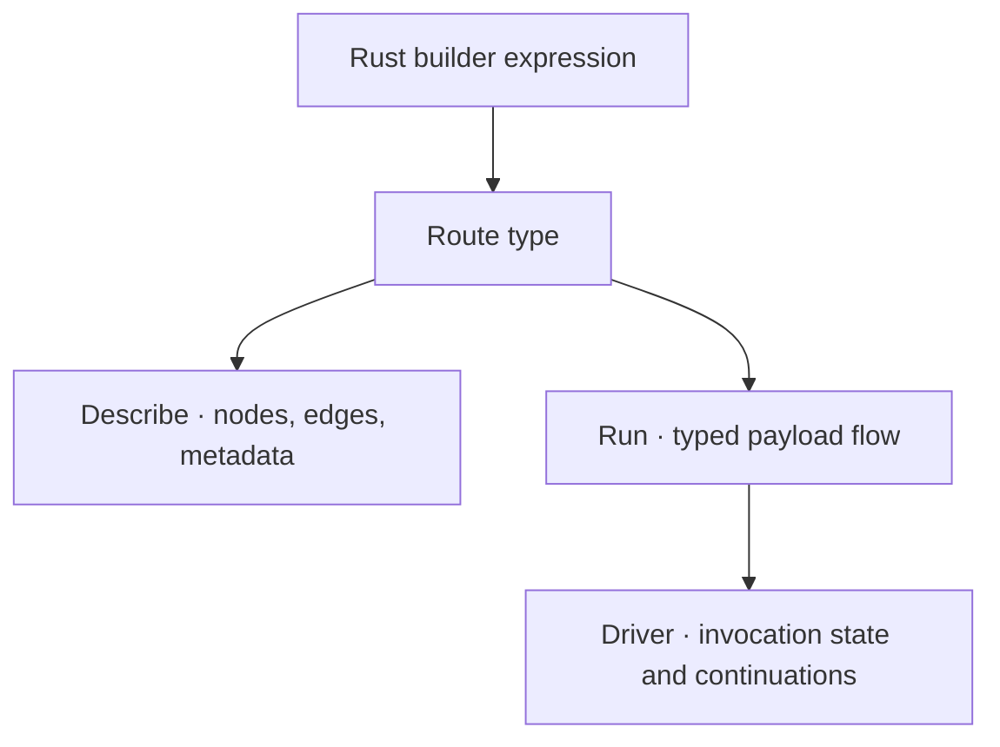

# Annotated step topologies

The [static_graph_routes](../crates/vihaco-runtime/examples/static_graph_routes.rs)
example implements this design. Its [framework](../crates/vihaco-runtime/examples/static_graph_routes/framework/mod.rs)
is local to the example. The [machines](../crates/vihaco-runtime/examples/static_graph_routes/machines/mod.rs)
module contains three consumers of the same framework.

## Route and invocation

A **route** describes the static wiring for one instruction step. Its nodes
identify operations and their machine fields where applicable. Its directed
edges identify which operation supplies a payload to which successor. Each
node and edge can carry application-defined static metadata.

An **invocation** runs a route with a machine, driver, and instruction. The
machine and driver supply runtime inputs such as message snapshots, module
context, signal handles, and worker results. A parked continuation owns the
values it needs to resume. A route is zero-sized and can be constructed and
inspected before a machine or driver exists. A second invocation can use the
same route with fresh inputs and signals.

One field can host multiple operations. Message preparation and instruction
execution at the same field are distinct nodes connected by an edge. Edges
express payload dependencies even when delivery happens within one component.
An external device completion or resource wait can be represented by a node
whose invocation supplies the concrete handle.

## Composing a route

The builder uses ordinary Rust functions and combinators. A node, sequence,
and fork/join are all paths. Any path can be used inline as the next path in a
sequence or as an arm of a fork/join. Callers can also extract a path into an
ordinary Rust function.

| Authoring API | Result |
| --- | --- |
| `build_message_at::<F>()` | A node that prepares an instruction message using `BuildMessage` for field `F`. |
| `compute::<C>()` | A node for an application-defined `Compute` operation with typed input and output. |
| `receive_effect_at::<F>()` | A node that invokes the receiver at field `F`. |
| `left.then(right)` | A sequence with an unannotated edge from the exit of `left` to the entry of `right`. |
| `left.then_via(edge, right)` | The same connection with an explicit edge description. |
| `fork_join(split, left, right)` | A path that splits its input into two owned values, runs the two arms, and produces their result pair. |
| `path.fork_edges(incoming, outgoing)` | The path configured as a fork arm with separately configurable edges from the split and into the join. |
| `fork.annotate_join::<A>()` | A fork/join with metadata on its join node. |

The step builder starts with `step_graph::<I>().begin(path)`. It accepts
auxiliary paths on either side of the designated instruction. Calling
`then_execute(instruction_at::<F>())` or `then_execute_via(edge, instruction_at::<F>())`
introduces the single instruction execution node and advances the builder state.
Only that state can call `finish()`. The type-state guarantee applies to the
declared graph. Application code inside a computation follows the machine's
behavioral contract.

The [capture route](../crates/vihaco-runtime/examples/static_graph_routes/machines/capture.rs)
composes a wait, an instruction, and a fork/join in one expression.

```rust,ignore
step_graph::<ops::Capture>()
    .begin(build_message_at::<DigitizerField>())
    .then(wait_for_signal::<ArmSignal>())
    .then_execute(instruction_at::<DigitizerField>())
    .then(fork_join(
        compute::<SplitCapture>(),
        spawn_task::<PredictResponse>().then(await_task::<PredictResponse>()),
        await_device_completion()
            .then(spawn_task::<AnalyzeCapture>())
            .then(await_task::<AnalyzeCapture>()),
    ))
    .then(compute::<CompareResults>())
    .then_via(
        edge().annotate::<CaptureResultLink>(),
        receive_effect_at::<ResultsField>().annotate::<ResultSink>(),
    )
    .finish()
```

Each constructor selects a static operation type. The capture declaration
selects an arm-signal input and two worker implementations. During execution,
message preparation supplies the current invocation's arm and device handles,
and the spawn nodes obtain fresh worker handles from the driver.

## Typed graph and inspection

The [graph module](../crates/vihaco-runtime/examples/static_graph_routes/framework/graph.rs)
represents a path as `Plan<P>`. Its type composes `Node<N, A>`,
`Sequence<L, E, R>`, and `ForkJoin<S, L, R, A>`. The finished route is a
`Route<I, P>` containing only a phantom marker for the instruction and path
types. Metadata values live in the annotation types' associated constants.

`Run<M, Input>` provides the execution interpretation. For a sequence, the
left path must run with `Input` and the right path must run with the left
path's associated output. For a fork/join, the split produces the pair of arm
inputs and each arm has its own output type. Cloning a payload is a choice
made by the split operation. The route entry point requires a terminal
`()` output.

`Describe` provides the inspection interpretation. `route.topology()`
projects node occurrences, selected field markers, edge endpoints, and metadata
from the same path types. It runs independently of `Run` and can inspect the
route without invoking any operation. Sequences derive endpoints from their
actual neighboring nodes. A fork records both edges into its join. Repeated
uses of a node type get distinct occurrence indices, including when they
target the same field. The indices are local to the projection and follow
traversal order. Stable identities for source mappings and exports remain
future work.



A DSL that emits Rust can lower a statically known topology directly to these
combinators. The capture route illustrates an entire generated expression with
inline arms. Its operation and metadata types refer to declarations available
to the compiler. Runtime operands or settings can change between starts while
the emitted connections remain fixed. A dynamically selected destination would
need an explicit graph operation and an inspection contract for its possible
endpoints.

## Static annotations

Node and edge metadata use the same extension contract:

```rust,ignore
trait Annotation: 'static {
    type Value: Any + Sync;
    const VALUE: &'static Self::Value;
}
```

An application chooses the tag and value type. For example, the
[waveform machine](../crates/vihaco-runtime/examples/static_graph_routes/machines/waveform.rs)
attaches a bus descriptor and a criticality flag to the DAC transfer. The
monitor has a different bus descriptor. Annotations can be stacked on a graph
item, and the inspection projection supports typed lookup by annotation tag.
If a tag is attached more than once, lookup returns the last value and the
projection retains the entries in attachment order.

```rust,ignore
compute::<Clamp<4>>().then_via(
    edge().annotate::<DacBus>().annotate::<Critical>(),
    receive_effect_at::<Dac>().annotate::<Critical>(),
)
```

Timing, resource requirements, labels, and priorities can all be described by
annotations. The prototype projects metadata for inspection, and its execution
driver advances work based on input readiness. A future interpreter can use static
computation-duration or transfer-latency annotations along with runtime
conditions. Current resource occupancy, actual device completion, and
per-invocation scheduling overrides belong to interpreter state.

## Execution and ownership

`Route::start(&self, machine, driver, instruction)` starts a fresh invocation
of the static path. `BuildMessage` prepares the input and the designated
`Execute` node invokes the component. Auxiliary computations and receivers use
their own contracts. Forwarding an effect to a receiver can be an immediate
handoff in this driver. The declared edge still identifies the dependency and
provides a place for metadata.

The [example driver](../crates/vihaco-runtime/examples/static_graph_routes/framework/runtime.rs)
keeps a queue of parked callbacks and a separate queue of terminal outcomes.
It borrows the machine to start or resume ready work. A parked wait owns its
handle and continuation, and the machine borrow ends when the current call
returns. Worker threads receive owned `Send + 'static` inputs and publish
owned results to the driver. They use completion channels, while the driver
applies downstream effects to the machine.

The capture route demonstrates two kinds of wait:

- The arm wait runs after message preparation and retains that invocation's
  prepared instruction and message. Placing a wait before preparation would
  make preparation read state after wakeup.
- The device wait consumes the completion handle produced by the instruction.
  `Execute` starts the acquisition once and returns that handle as part of
  its effect. The graph awaits the acquisition at a separate node and resumes
  from that node when the result is ready.

The fork/join keeps whichever arm result arrives first. Once both succeed,
their typed pair becomes the comparison node's input. A failed arm completes
the route with an error. A sibling already in flight can still finish, and
its late result cannot release the join a second time. Prior mutations and
independent effects are retained. Coordinated cancellation and aggregate
completion policies are follow-on work.

In the example, a submitting `Step::step` acknowledges acceptance. The driver
reports terminal success or failure through the outcome queue, including for
steps that complete inline. The synchronous program example uses
`run_synchronously` to return the terminal result directly to its caller.

Zero-sized route declarations establish that the topology itself occupies no
runtime storage. The example still allocates boxed callbacks at runtime, and
workers use channels and threads. An interpreter can choose another work
representation. Code-generation and performance comparisons against
handwritten steps remain open.

## Integration with program execution

The [static_execution_state](../crates/vihaco-stdlib/examples/static_execution_state.rs)
example pairs a program image with an
[ExecutionState and CPU machine](../crates/vihaco-runtime/examples/static_graph_routes/machines/execution_state.rs).
`Loadable::execute` fetches and dispatches each instruction. The authored step
runs the static path to completion before the next fetch. Control-flow nodes
use `ExecutionState` to update the PC and frames. CPU routes apply their
effects to the operand stack in a final computation node.

`build_message_with::<Field, Program>()` selects the module type in the
route. The runner supplies the borrowed instruction and module to
`run_synchronously`, and the preparation node uses them for that invocation.
The [inline interpreter](../crates/vihaco-runtime/examples/static_graph_routes/framework/synchronous.rs)
executes the same static node and sequence types and returns errors directly
to the runner.

The [execution-state runner](../crates/vihaco-stdlib/src/execution_state/runner.rs)
and [storage](../crates/vihaco-stdlib/src/execution_state/storage.rs) already
provide the hooks for a program-aware driver. The static-route example
demonstrates a parked graph continuation independently of these hooks.
Connecting the two preserves both the program's PC, frames, locals, and
operand stack and the route's progress within the current instruction.

1. Fetch at position `p` and establish the sequential continuation. Retain
   the originating position and invocation identity in the driver's work.
2. Begin the route. If it parks before the issue boundary, save the desired
   continuation PC `c` and call `suspend(parked)` before dispatch returns.
   The runner restores the visible PC to `p` and stops issuing instructions.
   A control-flow operation can change `c` from its sequential value.
3. On readiness, enter the public `run` initializer under the reentrancy
   guard. Restore the saved PC and runnable state with `resume_at(c)` before
   applying work that needs guarded program operations. Resume the saved
   route continuation with its completion value. If work parks again,
   suspend before returning from the initializer.
4. Allow instruction issue once the release boundary is satisfied, using the
   resulting PC. A stack result needed by the next instruction must be applied
   by that boundary. Independent external deliveries can remain in flight if
   the driver's policy permits it.

`ControlFlow::Break` yields from the custom runner while preserving the current
run state. A pending invocation needs `suspend` to prevent another runner call
from issuing an instruction. Keep the originating PC available for deferred
faults. Reset, replacement, cancellation, and snapshot cloning also need
defined behavior for outstanding handles and stale completions. Resume must
target the original invocation and its unchanged module.

## Example coverage

| Machine | Coverage |
| --- | --- |
| [Counter](../crates/vihaco-runtime/examples/static_graph_routes/machines/counter.rs) | A linear `Add` step through generated dispatch, with metadata on the instruction node and its incoming edge. |
| [Waveform](../crates/vihaco-runtime/examples/static_graph_routes/machines/waveform.rs) | Repeated clamp occurrences, distinct DAC and monitor transfers, multiple tags on one edge, and a join. The DAC receives clamped samples and the monitor receives the original. |
| [Capture](../crates/vihaco-runtime/examples/static_graph_routes/machines/capture.rs) | An arm wait, worker spawn and completion, device completion, and a join. Two invocations reuse the same route with different signals and inputs. |
| [ExecutionState and CPU](../crates/vihaco-runtime/examples/static_graph_routes/machines/execution_state.rs) | Sequential dispatch through branch, call, arithmetic, and return. An invalid branch reports a preparation error at the originating PC. |

Each demo checks that its route occupies zero bytes and inspects the topology
before constructing the machine and driver.

```sh
cargo run -p vihaco-runtime --example static_graph_routes --features typed-declarations
cargo test -p vihaco-runtime --example static_graph_routes --features typed-declarations
cargo run -p vihaco-stdlib --example static_execution_state --features program-image-execution
cargo test -p vihaco-stdlib --example static_execution_state --features program-image-execution
```

## Open integration questions

- Generate field routes for effect-only receivers and align the example's
  `Receive` contract with existing effect sinks.
- Define per-effect routing for zero, one, and many effects, conditional
  paths, and additional fan-out arities. Keep payload ownership explicit at
  each split.
- Decide how schedulers consume static annotations and combine them with
  runtime resource availability, hardware completion, and timing policy.
- Extend invocation-time program context to deferred routes. Define how
  those invocations retain the program reference they need at resume.
- Connect route parking to program instruction issue and specify release,
  cancellation, recovery, stale completion handling, and error reporting.
- Stabilize occurrence keys and DSL source mappings for topology exports and
  diagnostics, and measure optimized execution against handwritten steps.
