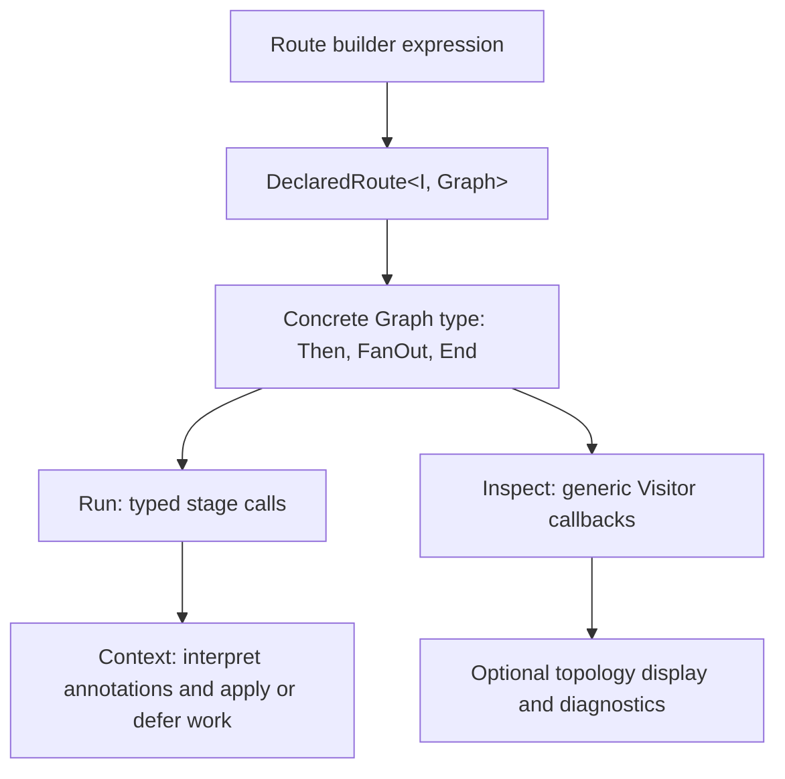
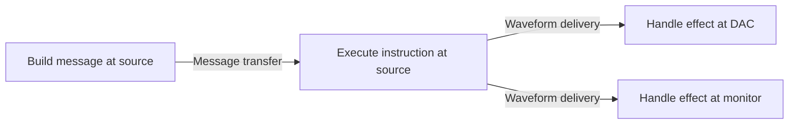
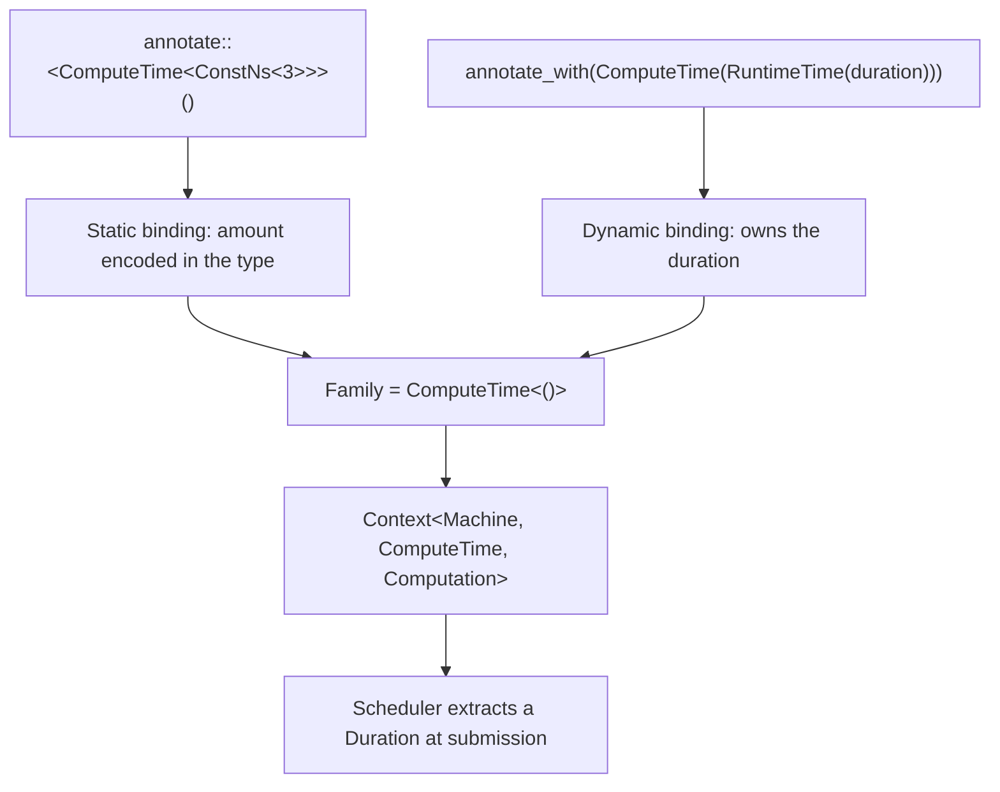
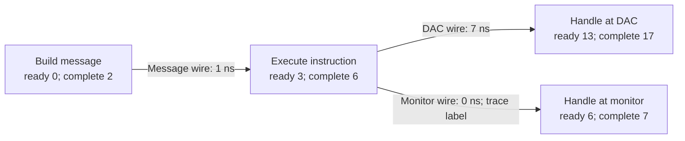
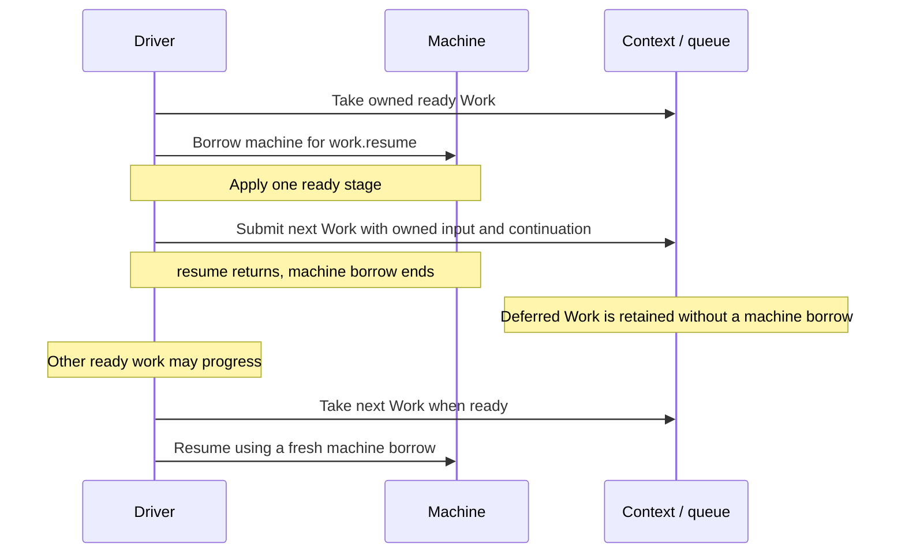
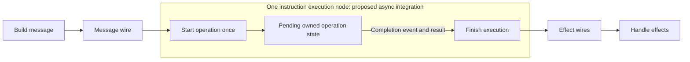
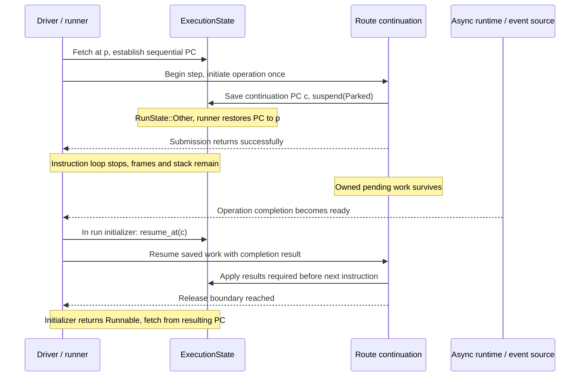

# Annotated step topologies

Status: initial design proposal with a runnable
[`annotated_route`](../crates/vihaco-runtime/examples/annotated_route.rs)
prototype. New routing APIs remain local to the example.

## Purpose

Each `Step<F, I, Context>` declares a static topology graph. Its computation nodes
build a message, execute one instruction, and handle the resulting effects.
Edges carry payloads between nodes. The step's context interprets annotations
on either nodes or edges, whether their values are static or supplied at runtime.

The graph must describe destinations, operations, connections, payload types,
and annotation types without running application code. An author can read the
message flow, an inspector can visit it, and an interpreter can execute it.
Typed routes and owned continuations come from the earlier
`../vihaco-static-top-experiment`.

## Routes as static topologies

A route's concrete Rust types describe the computations in one step: where they
run, which payloads connect them, and which branches receive the results. The
builder constructs a value of that type. Inspecting it does not invoke message
builders, instruction execution, or effect handlers.

The structure is static. Instructions, prepared messages, effects, and runtime
annotation values can vary between invocations of the same route type. A
scheduler controls when work becomes ready; the declared endpoints and
dependencies stay fixed. Failure may prevent a downstream node from running,
but that node remains part of the declared topology.

For example, a fixed 7 ns DAC delivery and a delivery with a runtime latency both
connect the source's execution node to the DAC's handling node. The connection
is known before any waveform exists. The context reads its annotation and
already knows the destination, without calling application code to find it.

One physical device may host several computation nodes. A destination says where
computation occurs; the operation kind distinguishes nodes at that destination.
Connections describe payload flow and dependencies independently of the
interpreter's physical transport. Supporting destinations chosen at runtime
would require an explicit boundary in the graph. The prototype has no such
boundary yet.

## Route describes the entire annotated graph

`Route` describes a complete step topology. Its associated `Graph` type contains
every computation node, payload transfer edge, branch, and annotation:

```rust,ignore
trait Route: Sized {
    type Instruction;
    type Graph;

    fn graph(&self) -> &Self::Graph;
    fn into_graph(self) -> Self::Graph;
    // Default methods execute or optionally describe that same graph.
}
```

The builder returns a concrete `DeclaredRoute<I, Graph>` implementing this
trait. It selects `Graph` at compile time. Graph values contain the runtime
annotation bindings when needed; the built-in topology operations and static
annotations are zero-sized. The example checks that a route with no runtime
bindings occupies zero bytes.

The graph composes these types: `Then<Operation, Annotation, Next>` is an annotated
node or edge followed by its continuation; `FanOut<Left, Right>` is a branch.
Operations retain their field and
instruction parameters, such as `BuildAt<Field, I>`, `MessageWire<Field>`,
`ExecuteAt<Field>`, `EffectWire<From, To>`, and `HandleAt<Field>`. Annotation
parameters retain `Static<A>` or `Dynamic<A>` at each graph position.

`Run` executes this graph through direct typed calls, and `Inspect` visits the
same types. There is one description to maintain. Execution needs no runtime
graph traversal, field-name resolution, or annotation registry. A context adds
runtime state when its behavior requires it, as scheduling does.

The builder, executor, and inspector share one graph description:



The arrows here show API relationships, not additional payload wires. Inspection
reads the declaration without running component behavior; execution uses that
same declaration without first building a runtime graph representation.

### Essential topology types

`Route::Graph` composes annotated stages and branches. The interfaces below
build, execute, suspend, or inspect that graph.

| Type or trait | Role |
| --- | --- |
| `Route` | Describes the complete step through its `Instruction` and `Graph` associated types |
| `DeclaredRoute<I, Graph>` | Concrete route returned by the builder; holds the graph's runtime bindings when present |
| `Stage<M, Input>` | Defines one computation or wire, its typed endpoints and payload, and how it produces its output |
| `Computation`, `Wire` | Type-level stage classifications used by context bounds and inspection callbacks |
| `Then<N, P, Next>` | Composes stage `N`, annotation policy `P`, and its continuation; `N` may be either a computation or a wire |
| `FanOut<L, R>` | Sends an effect into two branches; the prototype clones for one and moves into the other |
| `End` | Terminates a branch |
| `Static<A>`, `Dynamic<A>`, `Unannotated` | Represent type-only, value-bound, or absent annotations on a stage |

The prototype has five stage types:

| Stage | Computation or wire |
| --- | --- |
| `BuildAt<F, I>` | Builds instruction `I`'s message for field `F` |
| `MessageWire<F>` | Connects message construction to instruction execution at `F` |
| `ExecuteAt<F>` | Invokes the selected component's instruction execution |
| `EffectWire<From, To>` | Connects effect production to handling at another destination |
| `HandleAt<F>` | Applies the effect receiver's behavior at `F` |

`Stage` exposes `Kind`, `Source`, `Target`, `Instruction`, `Payload`, and `Output`
as associated types. A computation's source and target identify itself; a wire's
endpoints identify its producer and consumer computations. `Payload` describes
application data, while `Output` is the value passed to the continuation. For
example, message construction produces `PreparedInput<I, Message>`, which owns
the instruction alongside the message payload for later execution.

The example's graph composition is:

```text
Then<BuildAt>
  -> Then<MessageWire>
  -> Then<ExecuteAt>
  -> FanOut
       -> Then<EffectWire to DAC> -> Then<HandleAt DAC> -> End
       -> Then<EffectWire to monitor> -> Then<HandleAt monitor> -> End
```

Each `Then` has its own annotation parameter. `Policy` submits annotated work
to `Context` for interpretation. `Run` executes the composition, while
`Work<N, Input, Next>` owns a stage's input and continuation so that the context
can resume it later through `Resume`. `Inspect` and `Visitor` expose generic
callbacks for the graph's nodes and edges.

`Through`, `Building`, `Forwarding`, `Executing`, `Delivering`, and `Handling` are
builder states. They construct the graph while enforcing phase order and the
single instruction-execution boundary; they are not additional graph operations.

### Static execution and optional inspection

Each stage's associated `Kind` is either `Computation` or `Wire`. Owned work
retains its concrete operation, input, and continuation types. Because the
context receives `Kind` as a type parameter, trait resolution checks annotation
compatibility at compile time.

Inspection uses generic node and edge callbacks selected by the `Computation`
and `Wire` types. It does not materialize a tagged graph representation.
The example scheduler defaults to a zero-sized `NoRecording` observer; selecting
`RecordingScheduler` explicitly stores operation names and event times as
application diagnostic output. That output is not used for execution dispatch.

The performance goal is to compile an immediate route down to the message
preparation, instruction execution, and effect-handling calls an author would
write by hand. Runtime annotation storage, payload ownership, parking, and
scheduling still have their own costs. The example scheduler chooses a boxed
queue; another backend can choose a different representation. We still need
code-generation comparisons and benchmarks against handwritten routes.
Zero-sized graph values alone do not prove that routing has no overhead.

## Nodes and edges

A node identifies a computation at a destination. A destination can host more
than one node: message construction and instruction execution both occur at the
source field in this example. They are distinct computations with a message
transfer edge between them.



The example contains four nodes and three edges:

| Graph element | Location or connection | Behavior |
| --- | --- | --- |
| Message construction node | Source field | Resolve and validate execution input through `BuildMessage` |
| Message transfer edge | Source message node to source execution node | Make the prepared message available to execution |
| Instruction execution node | Source field | Invoke its `Execute<I>` once |
| DAC delivery edge | Source execution node to DAC handling node | Make the waveform effect available to the DAC |
| DAC handling node | DAC field | Apply receiver behavior through `Receive<E>` |
| Monitor delivery edge | Source execution node to monitor handling node | Make the waveform effect available to the monitor |
| Monitor handling node | Monitor field | Apply receiver behavior through `Receive<E>` |

An edge describes when a payload becomes available to its consumer, including
when both endpoints share a component. It need not correspond to a physical
network. The borrowed instruction enters at the route boundary; the prototype
does not model its arrival as another edge.

## Step boundary

Each declared step contains exactly one instruction execution node:

```text
Build message -> transfer message -> Execute instruction -> propagate effects
```

Failures can prevent execution, and scheduling can defer it. Neither changes the
single-execution boundary. `Execute` refers exclusively to instruction execution.
Receiver computation is a separate node using a separate contract:

```rust,ignore
trait Receive<E> {
    fn receive(&mut self, effect: E) -> eyre::Result<()>;
}
```

Delivery makes an effect available; handling applies it. Handling does not
implicitly invoke another instruction. Any subsequent instruction execution
belongs to another step; how such steps are initiated remains open.

Builder states enforce the phase progression. `.execute()` is available after
message-transfer configuration and disappears once selected. Propagation
builders provide `.handle_effect()`, with no instruction-execution method.

## Authoring a topology

The fixed-timing route in the prototype is:

```rust,ignore
route_through::<field!(Machine::source)>()
    .build_message::<commands::Fire>()
    .annotate::<ComputeTime<ConstNs<2>>>()
    .forward_message()
    .annotate::<DeliveryLatency<ConstNs<1>>>()
    .execute()
    .annotate::<ComputeTime<ConstNs<3>>>()
    .fan_out((
        deliver_to::<DacField>()
            .annotate::<DeliveryLatency<ConstNs<7>>>()
            .handle_effect()
            .annotate::<ComputeTime<ConstNs<4>>>(),
        deliver_to::<MonitorField>()
            .annotate_with(TraceLabel("monitor delivery"))
            .handle_effect()
            .annotate::<ComputeTime<ConstNs<1>>>(),
    ))
    .start(self, context, instruction)
```

Each annotation decorates the immediately preceding node or edge. The monitor
edge demonstrates an application annotation other than timing; this scheduler
records the label and applies zero transfer delay.

`route_through::<F>()` selects the instruction field directly. The machine type
is inferred from `self` at `.start(...)`, where compatibility bounds are checked.
Field markers identify declaration fields and may be shared by generic
instantiations; they cannot determine a concrete parent type on their own.
`deliver_to::<F>()` creates an edge directly, without a separate branch starter.

The prototype uses explicit `DacField` and `MonitorField` implementations. These
are effect-only receivers, while the current composite macro generates field
routes for instruction devices. Generated accessors should eventually permit
`deliver_to::<field!(Machine::dac)>()` and the equivalent monitor spelling.

Building the route does not execute it.
`.inspect::<Machine, _>(&mut visitor)` visits the graph's types without a machine
instance, context, or instruction value. `.start(...)` begins interpretation
with borrowed access to the machine and context.

### Waveform computation

`Fire` contains an output channel and an amplitude multiplier. Its custom
`BuildMessage` implementation loads waveform samples and calibration from
machine state into an owned `PulseMessage`. The source's `Execute` computes:

```text
output_sample = sample * instruction_amplitude * calibration_gain + offset
```

The source delivers the resulting waveform to two receivers. The DAC handler
validates its output range and records the waveform. The monitor records sample
count and peak amplitude. These implementations contain the application logic;
the graph names the destinations.

### Dynamic timings

The runtime route uses the same nodes and connections, attaching runtime values:

```rust,ignore
.build_message::<commands::FireRuntime>()
.annotate_with(ComputeTime(RuntimeTime(Duration::from_nanos(2))))
.forward_message()
.annotate_with(DeliveryLatency(RuntimeTime(Duration::from_nanos(1))))
.execute()
.annotate_with(ComputeTime(RuntimeTime(execution_duration)))
```

Runtime annotations can also decorate delivery edges and handling nodes. The
example's runtime route uses runtime-valued computation durations for message
construction and both handlers, as well as runtime delivery latencies. A mixed
route combines fixed computation durations with runtime DAC delivery latency.
Dynamic data changes annotation values, not the graph's connections.

## Graph description

The graph describes itself through associated types. Each `Stage<M, Input>`
exposes its computation/transfer `Kind`, `Source`, `Target`, `Instruction`,
`Payload`, and `Output` types. For a computation, source and target identify that
operation itself. A message-transfer edge names `BuildAt<Field, I>` as its source
and `ExecuteAt<Field>` as its target. An effect-transfer edge names
`ExecuteAt<From>` and `HandleAt<To>`.

These connections are available before payloads exist. Field types retain nested
path identity; the concrete machine is the `M` parameter. Display-name accessors
read the fields' source names only when a caller explicitly requests them.

Optional inspection walks the statically selected composition through generic
callbacks:

```rust,ignore
trait Visitor<M> {
    fn node<N, Input, A>(&mut self, annotation: &A)
    where
        N: Stage<M, Input, Kind = Computation>,
        A: AnnotationInfo;

    fn edge<N, Input, A>(&mut self, annotation: &A)
    where
        N: Stage<M, Input, Kind = Wire>,
        A: AnnotationInfo;
}
```

`Inspect` implementations follow `Then` and `FanOut` types. Each stage's `Kind`
selects the callback through trait resolution. The visitor receives the exact
operation and annotation types and a reference to the annotation binding. The
example visitor counts nodes and edges, checks endpoint connectivity, and prints
type names. Its output lists belong to the example, not the framework graph.

`AnnotationInfo` exposes the annotation value type and a static storage label for
unannotated, static, or runtime bindings. There is no separate metadata container
or runtime classification enum. Generic inspection of arbitrary annotation
values would need annotation-specific interfaces beyond the current type and
storage information.

Recording follows the same principle: work retains its concrete `Operation`
type, and the optional observer records that type's name and event times.
Names are diagnostic output, not stable identifiers or execution keys. Repeated
occurrences of an operation would need occurrence identities for stable export;
the prototype contains one node per operation/field pair.

## Annotation model

The attachment point and the annotation representation are independent:

| Attachment | Static form | Runtime form |
| --- | --- | --- |
| Computation node | `.annotate::<ComputeTime<ConstNs<3>>>()` | `.annotate_with(ComputeTime(RuntimeTime(duration)))` |
| Wire edge | `.annotate::<DeliveryLatency<ConstNs<7>>>()` | `.annotate_with(DeliveryLatency(RuntimeTime(delay)))` |

The builder's current phase determines the attachment point. For example:

```rust,ignore
deliver_to::<DacField>()
    .annotate::<DeliveryLatency<ConstNs<7>>>() // Edge: source output to DAC input.
    .handle_effect()
    .annotate_with(ComputeTime(RuntimeTime(duration))) // Node: DAC handling work.
```

The two annotations describe independent costs: payload arrival on the edge,
then computation at the node. Each annotation applies only to its graph element.
A node's annotation leaves its wires unchanged, as does one branch's annotation
for its siblings. The interpreter receives annotations on declared graph
elements; they do not annotate arbitrary statements inside an operation.

Applications define what annotations mean. Besides timing, they could describe
resource requirements, tracing, or priority. The routing core leaves their
interpretation and support on nodes or edges to the context.

### Static and runtime amount representations

Timing semantics and amount storage are separate type parameters:

```rust,ignore
struct ConstNs<const NS: u64>;
struct RuntimeTime(Duration);

struct ComputeTime<Amount = ()>(Amount);
struct DeliveryLatency<Amount = ()>(Amount);

trait TimeAmount {
    fn duration(&self) -> Duration;
}

trait StaticTimeAmount: TimeAmount {
    const DURATION: Duration;
}
```

`ConstNs<NS>` is a zero-sized amount whose duration is encoded in its type and
exposed through the associated constant. `RuntimeTime` owns one `Duration` and
implements the shared `TimeAmount` interface. It does not implement
`StaticTimeAmount`, so a type-only annotation cannot use it.

Both timing annotations implement `StaticAnnotation` whenever their amount
implements `StaticTimeAmount`, and `RuntimeAnnotation` whenever it implements
`TimeAmount`. The same generic annotation definitions therefore support:

```rust,ignore
.annotate::<ComputeTime<ConstNs<3>>>()
.annotate_with(ComputeTime(RuntimeTime(execution_duration)))

.annotate::<DeliveryLatency<ConstNs<7>>>()
.annotate_with(DeliveryLatency(RuntimeTime(delivery_delay)))
```

The fixed and runtime forms have different concrete amount types, but no separate
annotation definitions or runtime representation tags. A static amount can also
be passed through the value-binding API without adding stored amount data.
Static annotations remain usable entirely in type position.

This follows nalgebra's separation between the common
[`Dim`](https://docs.rs/nalgebra/latest/nalgebra/base/dimension/trait.Dim.html)
interface and the stronger static
[`DimName`](https://docs.rs/nalgebra/latest/nalgebra/base/dimension/trait.DimName.html)
interface. The example uses safe duration traits and does not introduce
nalgebra as a dependency. Compile-time arithmetic over amounts remains future
analysis work.

### Annotation families and context capabilities

A context declares support for an annotation family rather than enumerating
individual const amounts or storage forms. The machine example uses:

```rust,ignore
trait MachineContext:
    Context<Machine, ComputeTime, Computation>
    + Context<Machine, DeliveryLatency, Wire>
    + Context<Machine, TraceLabel, Wire>
{
}
```

A blanket implementation makes compatible contexts qualify automatically. All
three step variants use `C: MachineContext`. Adding `ComputeTime<ConstNs<13>>` or any
other supported amount requires no change to these bounds.

The annotation structs also identify context capabilities. In context bounds,
`ComputeTime` means `ComputeTime<()>` and `DeliveryLatency` means
`DeliveryLatency<()>`, using the default amount parameter. These forms identify
semantics without choosing an amount or constructing an annotation instance;
`()` is not a `TimeAmount` and cannot accidentally supply an actual duration.
`TraceLabel` directly identifies tracing support too.

Both timing capability forms implement `AnnotationFamily` with `Value = Duration`.
`TraceLabel` uses a label value. `ComputeTime<ConstNs<NS>>` and
`ComputeTime<RuntimeTime>` share the family `ComputeTime<()>`; both forms of
`DeliveryLatency<Amount>` share `DeliveryLatency<()>`. This associated type groups
the bindings without separate family marker structs, registry keys, or runtime
variants.

```rust,ignore
trait AnnotationFamily {
    type Value;
}

trait AnnotationBinding {
    type Family: AnnotationFamily;
    fn into_value(self) -> <Self::Family as AnnotationFamily>::Value;
}

trait Context<M, Family: AnnotationFamily, Kind>: Sized {
    fn submit<A, W>(
        &self,
        machine: &mut M,
        annotation: A,
        work: W,
    ) -> eyre::Result<()>
    where
        A: AnnotationBinding<Family = Family>,
        W: Resume<M, Self, Kind = Kind> + 'static;
}
```

Submission is generic over the binding, so the graph and context method retain
the full `Static<ComputeTime<ConstNs<7>>>` type, including its constant. The
scheduler extracts a duration when it schedules the work. Rust can constant-fold
fixed amounts; the scheduler reads runtime amounts from the binding.

For computation timing, both representations reach the same context capability:



The shared family selects the capability bound. Each submission still carries
its concrete binding type into the generic context method. Delivery latency
follows the same path with `DeliveryLatency` and `Wire`.

`.annotate::<A>()` supplies a zero-sized `Static<A>` marker. The annotation author
implements `StaticAnnotation` on `A`, providing its family and a static value
function without constructing an `A` instance or requiring `Default`.
`.annotate_with(value)` supplies `Dynamic<A>`; its `RuntimeAnnotation`
implementation consumes the value to obtain the family's interpreted value.
Blanket `AnnotationBinding` implementations adapt both wrappers. Custom
annotations implement these traits on their own types, rather than requiring
implementations on framework-owned wrappers.

One scheduler implementation of `Context<M, ComputeTime, Computation>` handles
all fixed and runtime computation durations. Delivery latency is supported on
`Wire`; applying that family to a computation has no matching implementation and
fails type checking. Other families can support either or both graph kinds.
An annotation can still combine static resource identity with runtime quantities.

The builder supports one annotation per node or edge. We still need to decide
how to attach several annotations and how they interact. Types provide the
information for static checks and specialized interpreters; compile-time graph
analysis is not implemented yet.

## Context and timing semantics

The immediate context ignores annotations and completes the graph synchronously.
The scheduler interprets node computation duration and edge delivery latency
separately. Inputs are ready when a part is submitted. A computation's modeled
start is that readiness time; the scheduler applies its body atomically at
completion, making outputs available then:

```text
node_completion = node_start + computation_duration
edge_arrival = producer_completion + delivery_latency
consumer_start = edge_arrival
```

The last equation assumes no resource contention. This simulator does not reserve
resources or mutate state at computation start. A hardware interpreter could
instead initiate work and await completion, while retaining the same graph.

For fixed timings:

| Event | Time |
| --- | --- |
| Message construction becomes ready | 0 ns |
| Message construction completes | 2 ns |
| Prepared message arrives at instruction execution | 3 ns |
| Instruction completes and produces waveform | 6 ns |
| Monitor receives waveform | 6 ns |
| Monitor handling completes | 7 ns |
| DAC receives waveform | 13 ns |
| DAC handling completes | 17 ns |

Each wire delays consumer readiness after producer completion. The diagram uses
modeled nanoseconds; the scheduler does not wait for wall-clock time:



The monitor completes while the DAC waveform is still in transit. The two
branches depend on execution completion, not on each other's progress.

When the waveform arrives at the DAC, the scheduler submits its handler as a
separate four-nanosecond computation. Both the graph and scheduler records
distinguish arrival from handling.

The scheduler orders equal deadlines by submission sequence, advances modeled
time without wall-clock waits, and erases continuation types only in its queue.
Its optional recording observer records each part's ready time, due time, and
successful completion. The single-threaded example uses `Cell` and `RefCell`
to mutate scheduler state through `&Context`. Unannotated stages run synchronously;
we have not yet decided how an interpreter would take control of those stages.

## Ownership and message snapshots

Each deferred part owns its input and remaining graph. Execution borrows its
environment only while applying a part:

```text
Acquire borrowed environment
    -> apply ready part
    -> produce owned output and continuation
    -> submit the next node or edge
    -> release borrows
```

Across a deferred boundary, owned work survives while the machine borrow ends:



This shows the deferred scheduling path. An immediate context instead resumes
submitted work synchronously without retaining it in a queue.

Submission clones the instruction. The scheduled message builder reads samples
and calibration when its body runs: at completion, 2 ns into the fixed route.
It does not read them at `Step` submission. The built message owns that snapshot,
so later calibration changes during transfer or instruction scheduling do not
alter the execution input.

The current shared entry path also clones the instruction for immediate
execution. A borrowed immediate path should avoid that requirement when no work
is deferred; instruction cloning is a prototype ownership choice, not part of
the static topology contract.

The message-transfer continuation owns both the instruction and prepared message.
Instruction completion produces a waveform; each effect branch then owns its
payload through transfer and handling. The prototype clones the waveform for
one branch and moves it into the other.

`Resume<M, C>` exposes a stage's kind and operation as associated types and resumes
it with fresh borrows of the machine and context. An implementation could instead
retain an owning program reference and instruction index to avoid cloning the
instruction. Support for other execution environments, multithreaded workers,
and sharing strategies remains open. The queue currently requires `'static`
work; it has no `Send` bound.

The `BuildMessage` call still receives `()` as its preparation context.
Forwarding runtime preparation context and modeling explicit capture before a
computation starts require further design.

## Async execution and parking integration

The prototype schedules synchronous work at modeled deadlines. Async support is
still a proposal: it needs a way to wait for a future or external event as well
as a way to model elapsed time.

### Parking before work and awaiting work already started

A wait before execution retains the owned instruction and input until its
condition is satisfied, then runs the computation once. The graph should declare
this dependency. Its types identify what is awaited; runtime keys can identify
a particular signal, resource, or operation instance. Wait placement matters:
before message construction, the builder resolves inputs after waking; after
construction, execution uses the snapshot it already owns.

Async instruction execution starts an operation once, parks while it is pending,
and completes the same execution node when its result arrives:



The execution node starts once and finishes when the result arrives. The phases
shown inside it would require an extension to the current graph API; they do not
introduce more `Execute` invocations.

An owned pending value could be a concrete future or a typed wait descriptor.
It carries operation state and the continuation expecting its completion result.
On readiness, a typed completion work item supplies the result to the remaining
graph. Waking must not call the instruction's initial execution again.

Today, `Stage::apply`/`Run` immediately passes output downstream, and `Resume`
cannot accept an external completion payload. Async execution needs a typed
adapter or contract that separates starting an operation from completing it.
`Execute<I>::Effect` can already hold an owned pending value, but the graph still
needs support to wait for it and finish the node. Retain owned operation state
and handles while waiting, then borrow the machine again on completion. Holding
a borrow of the whole machine across suspension would block independent work.

### Runtime driver and instruction issue

A driver owns ready and parked work. An async runtime waits for timers, signals,
or I/O completions and makes the associated typed continuation ready. The driver
borrows the machine only while applying ready work, so parked instructions do
not prevent other runnable work from progressing. External tasks can communicate
results to the machine owner through channels. The graph does not require a
separate runtime task for every instruction.

The program runner sets the sequential PC before dispatch. Its suspension hooks
([PR #198](https://github.com/QuEraComputing/vihaco/pull/198)) let a route stop
instruction issue before returning successfully. The driver must associate
pending work with the invocation that issued it and track completion.
`Ok(())` from `Step` only acknowledges submission. Save the desired continuation
PC before suspending: dispatch restores the visible PC to the originating
instruction, but waking must resume the owned route without redispatching it.

The driver must define which boundary releases the issuing stream: instruction
completion, a particular effect-handling completion, or an explicit join. Other
effect branches may continue independently. A wait registry must define event
consumption, registration ordering, cancellation, and handling of stale results
from an earlier invocation.

### ExecutionState integration

Parking preserves two continuations. `ExecutionState` holds the program's PC,
frames, locals, and operand stack. The owned route work holds progress within
the current instruction. Resuming uses both without starting another instruction
or reconstructing a frame.

The suspension gate from [PR #198](https://github.com/QuEraComputing/vihaco/pull/198)
uses `ExecutionState<S>` with `RunState::{Runnable, Halted, Other(S)}`.
`suspend(state)` stores custom state in `Other`. The shared runner loops only
while `Runnable`, and `execute_instruction` rejects a suspended state. Calling
ordinary `resume` while parked therefore returns without issuing an instruction.
The separate `executing` flag guards against reentrant runner calls.

`execute_instruction` advances the PC before dispatch. If dispatch fails or leaves
the state other than `Runnable`, including suspension, it restores the originating
position. Save the desired continuation before calling `suspend`; `resume_at(pc)`
restores it and marks the state runnable. A control-flow instruction may already
have changed that continuation, so it is not necessarily `p + 1`.

The proposed driver connects the existing execution-state hooks to owned route
work as follows. `c` is the saved continuation PC, including any control-flow
change made during dispatch:



This diagram follows a completion that reaches the release boundary. If resumed
work parks again, it suspends before returning and the fetch loop stays stopped.

The intended lifecycle using these hooks is:

1. Fetch at position `p` and establish the sequential continuation as today.
   Retain the originating position and the association with this invocation in
   the pending work.
2. Prepare and execute the route. If preparation consumes operands, the owned
   prepared message retains them. Parking must not repeat those pops or the
   instruction's initial side effects.
3. Save the desired continuation PC in a custom state such as
   `Parked { resume_pc }`, then call `suspend(parked)` before dispatch
   returns. The runner restores the visible PC to `p` and stops. Frames, locals,
   and stack remain intact. Store typed pending work with the context or backend;
   `ExecutionState` need not own a future or heterogeneous work queue.
4. On readiness, use the public `run` initializer to inspect the parked state,
   restore its continuation with `resume_at`, and resume the saved route. The
   initializer runs under the reentrancy guard before the instruction loop,
   including when the state was suspended. Restore `Runnable` before applying
   continuations that need guarded program operations; suspend again if they
   park. CPU stack effects can use an effect-receiver adapter around the existing
   `Apply` behavior. Finish the state changes required by the route's release
   boundary before allowing the initializer to return runnable.
5. Fetch from the resulting PC, which may have been changed by control-flow
   behavior. Do not increment it again or redispatch position `p` on wakeup.

`ControlFlow::Break` from the custom runner only yields control; it does not mark
an instruction parked. Use `suspend` to prevent another runner invocation from
issuing the next instruction while completion is pending.

For example, a parked operation that returns a stack value must apply that value
before the next instruction can consume it. Independent external deliveries
may remain in flight after release if the route's declared completion boundary
allows that. Other devices or invocations with separate execution state can
progress while this invocation is parked.

If a backend looks up pending continuations by ID, the custom state can also hold
`pending: PendingOperationId`. A driver that already owns the continuation and
knows its execution state needs no such ID. "Ticket" and `PendingOperationId`
are placeholder names, not vihaco types or requirements of PR #198.

Pending work must retain enough ownership or identity to resume the right
invocation against the same unchanged module. Reset, cancellation, and invocation
replacement invalidate it. Cloning an execution snapshot must not duplicate a
live wait registration. Deferred faults keep their originating instruction
position without automatically replaying side effects that may already have
occurred.

The routing example has not yet connected owned continuations to these
execution-state hooks. That needs a driver with rules for applying results,
retaining pending work, and handling readiness and deferred errors. Implement
this parking path before adding an async-runtime adapter. The debugger replays
displaced instructions to handle breakpoints; an async route resumes its saved
continuation instead.

### Static topology and backend costs

Wait conditions, completion result types, and continuation types remain part of
the statically selected graph. Runtime values identify particular events and
operations. Async integration need not add runtime graph enums or force futures,
allocation, or task spawning onto synchronous routes. A backend can choose
typed tasks, generated work representations, or queue erasure according to its
requirements; cross-thread work needs suitable ownership and `Send` bounds at
that boundary.

Computation-duration annotations describe modeled timing. Completion events
determine when async work is actually ready. The context must define how those
interact, which clocks it uses, and when work occupies resources. The first
implementation should support explicit waits and typed completion through the
driver; an async-runtime adapter can then supply readiness events.

## Failures and completion

Successful `Step::step` means initial submission succeeded, not that the graph
completed. Message preparation can now fail later when its node runs. Instruction
execution and receiver handling can fail at their modeled completion times.
Failed parts do not produce downstream work; the scheduler returns the error.

Successful mutations, submissions, and other branches are not rolled back. A DAC
range failure can occur after the monitor has already completed. Cancellation,
retries, and aggregate completion reporting are unresolved. Finite topology
inspection and a single instruction execution remain independent of such
runtime outcomes.

## Framework and user responsibilities

Machine authors write the machine declaration, component behavior, and a route
expression in each `Step`. The framework supplies the graph types and ownership
machinery.

| Concern | Provided by vihaco | Written or selected by the machine author |
| --- | --- | --- |
| Machine structure | Declaration macros, generated field markers, `Field` access | Components, composite fields, and state |
| Message construction | `BuildMessage` contract, existing automatic preparation, and a graph node invoking preparation | Application messages and custom resolvers where needed |
| Instruction execution | `Execute<I>` contract and field-directed execution node | Instructions and component execution behavior, or reused components |
| Step topology | `Route` trait, canonical typed graph, and builder with phase checking for nodes and edges | Explicit destinations, connections, and node/edge annotations |
| Effect receiving | Receiving contract, field access, and payload compatibility bounds | Receiver behavior and application transformations |
| Annotation attachment | Static type markers and runtime value ownership | Chosen annotations, constants, values, and any custom annotation definitions |
| Interpretation | One `Context` extension contract and an immediate interpreter | A provided context or custom scheduling/resource policy |
| Deferred work | Typed stages, owned inputs, continuations, and resumption | Custom boundary representations only for specialized integrations |
| Description | Generic inspection callbacks over typed nodes, edges, and annotations | Visitor implementation and application-specific presentation |

Existing `Field`, `BuildMessage`, `Execute`, and `Step` already come from vihaco.
The new graph APIs are currently example-local. Machine authors should not need
to implement internal `Stage`, `Run`, `Work`, `Policy`, or builder state types.
These internals represent nodes and edges, enforce their composition, and
construct owned continuations. Explicit receiver field accessors are temporary
scaffolding pending generated access for effect-only destinations.

Annotation authors define metadata and how a context interprets it. Interpreter
authors reuse the graph's work types and implement submission, scheduling or
recording, and resource policies. The timing annotations, tracing label, and
scheduler should be reusable rather than copied into each machine. We have not
decided whether they belong in the standard library or an optional runtime
package. Hardware environments may still need their own schedulers.

## Prototype and validation

| File | Responsibility |
| --- | --- |
| [framework.rs](../crates/vihaco-runtime/examples/annotated_route/framework.rs) | Typed graph operations, builder, generic inspection, and owned work |
| [annotations.rs](../crates/vihaco-runtime/examples/annotated_route/annotations.rs) | Amount representations, generic timing annotations, and semantic families |
| [contexts.rs](../crates/vihaco-runtime/examples/annotated_route/contexts.rs) | Typed timing interpretation, optional scheduling, and opt-in recording |
| [machine.rs](../crates/vihaco-runtime/examples/annotated_route/machine.rs) | Instructions, message builder, source execution, receivers, and authored steps |
| [annotated_route.rs](../crates/vihaco-runtime/examples/annotated_route.rs) | Inspection, runnable scenarios, and assertions |

```sh
cargo run -p vihaco-runtime --example annotated_route --features typed-declarations
cargo run -p vihaco-runtime --example annotated_route --features typed-declarations -- 2 4
```

Arguments supply instruction computation duration and DAC delivery latency in
nanoseconds. Other durations in the runtime route are runtime-valued annotations
with example defaults. For the second invocation:

| Route | Instruction completion | Monitor completion | DAC arrival | DAC completion |
| --- | --- | --- | --- | --- |
| Fixed | 6 ns | 7 ns | 13 ns | 17 ns |
| Runtime instruction duration 2 ns and DAC latency 4 ns | 5 ns | 6 ns | 9 ns | 13 ns |
| Fixed instruction duration and runtime DAC latency 4 ns | 6 ns | 7 ns | 10 ns | 14 ns |

Assertions cover graph connectivity and computation kinds, annotation storage
forms, one instruction execution, node and edge timing, calibrated output,
owned inputs across suspension, preparation and handling failures, snapshot
timing, zero-sized static graph values, execution without recording, and new
static amounts submitted through unchanged family bounds. Both generic timing
annotations occupy zero bytes with a static amount and one `Duration` with a
runtime amount, as checked by the assertions. Negative compilation checks reject
delivery latency on a computation node and a runtime amount in the type-only
annotation API. Focused runs, formatting, and Clippy checks validate the prototype.

## Integration questions

Before promoting the API into vihaco, resolve:

1. Generated fields for effect-only receivers and integration with existing
   effect-sink contracts.
2. Annotation accumulation, composition, and additional static analyses of the
   canonical graph.
3. Zero/one/many effects, variant selection, transformations, general fan-out,
   and payload sharing.
4. Resource-aware node starts, asynchronous computation completion, message
   capture semantics, and preparation context forwarding.
5. Borrowed immediate inputs, owned program references, consumers with different
   execution environments, and threading requirements.
6. Stable topology export, node/edge occurrence identities, dynamic annotation
   inspection, nested paths, and compile-time analyses.
7. Completion, cancellation, recovery, and subsequent-step initiation.
8. Optimized code generation and performance against equivalent handwritten
   routes, including contexts without scheduling or tracing.

The central constraints are explicit static connections, separately annotatable
computation nodes and transfer edges, exactly one instruction execution per step,
and owned continuation data at deferred boundaries.
